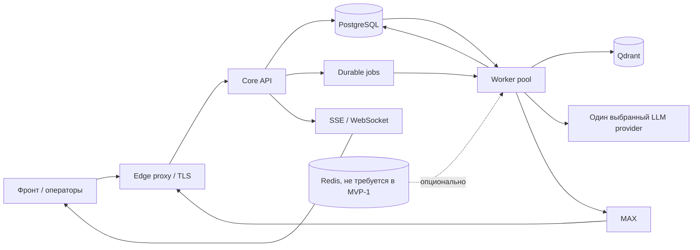

# Техническое задание: backend сервиса «ИИ-продавец»

## 0. Технические требования к серверу и окружению

### 0.1. Назначение и допущения

Требования ниже задают экономную стартовую конфигурацию для пилотного MVP с небольшой нагрузкой, а не гарантированную производительность при любом количестве пользователей. Предполагается один Linux-сервер, на котором напрямую устанавливаются backend и необходимые зависимости. Ожидаемые объёмы проектов, диалогов, каталога, вложений и одновременных запросов необходимо проверить нагрузочными испытаниями. Вызов LLM предполагается через внешний API, поэтому GPU для MVP не требуется.

### 0.2. Базовая конфигурация сервера

| Ресурс | Минимум для тестового запуска | Рекомендация для пилота |
|---|---:|---|
| Архитектура | Linux x86_64, 64-бит | Ubuntu Server 24.04 LTS или совместимый поддерживаемый дистрибутив |
| CPU | 2 vCPU | 4 vCPU |
| RAM | 4 ГБ | 8 ГБ |
| Диск | 50–60 ГБ SSD | 80–100 ГБ SSD |
| Сеть | Стабильный доступ в интернет и публичный HTTPS endpoint | Для webhook и внешних API; входящие порты ограничить необходимыми |
| GPU | Не требуется | Не требуется при использовании внешнего API LLM/embeddings |

Минимальная колонка рассчитана на разработку и ограниченный тестовый запуск, а не на производственную нагрузку. Рекомендация для пилота предполагает один сервер со стеком из этого ТЗ и небольшим количеством одновременных диалогов. Окончательный размер подтверждается нагрузочными испытаниями и фактическим потреблением ресурсов; резервные копии хранятся вне сервера.

### 0.3. Обязательное программное обеспечение

| ПО / сервис | Требование |
|---|---|
| ОС | Ubuntu Server 24.04 LTS либо совместимый поддерживаемый Linux-дистрибутив с регулярными обновлениями безопасности |
| Backend runtime | Python 3.12 для API и worker-процессов; приложение устанавливается непосредственно на сервер в виртуальное окружение Python, зависимости фиксируются lock-файлом проекта |
| Основная БД | PostgreSQL 16 или совместимая поддерживаемая версия; миграции схемы выполняются отдельно и контролируемо |
| Векторная БД | Qdrant, совместимая с версией клиентской библиотеки проекта; индекс восстанавливаем из первичных данных |
| Кэш/координация | Redis 7 при включении Redis в выбранной конфигурации; он не является источником истины для задач, Inbox или Outbox |
| Reverse proxy / ingress | Nginx, Caddy либо эквивалент для HTTPS/TLS, маршрутизации, ограничения размера запросов и rate limiting на периметре |
| Файлы и документы | На старте допускается закрытый каталог на сервере с отдельными правами доступа и резервным копированием; при росте перейти на S3-compatible хранилище |
| TLS-сертификаты | Действующие сертификаты для публичных API и webhook endpoint; автоматическое продление или регламент их обновления |

Версии ОС, баз данных и библиотек должны быть зафиксированы в документации/конфигурации проекта и регулярно обновляться с проверкой совместимости.

### 0.4. Сетевые доступы и конфигурация окружения

1. Публично открывать только HTTPS ingress (обычно TCP 443) и административный SSH-доступ через ограниченный список адресов или VPN. PostgreSQL, Redis и Qdrant не должны быть доступны напрямую из интернета.
2. Разрешить исходящие HTTPS-запросы к MAX и выбранному LLM/embedding-провайдеру. Другие домены открываются только при подключении соответствующей интеграции на следующих этапах.
3. Предусмотреть отдельные окружения `development`, `staging` и `production` с независимыми базами, секретами, webhook URL и тестовыми учётными данными.
4. Настройки передавать через environment/configuration; секреты хранить в закрытых конфигурационных файлах с ограниченными правами доступа либо в secret manager. Не включать реальные credentials в репозиторий, примеры конфигурации и логи.
5. Настроить системную синхронизацию времени (NTP), поскольку она нужна для проверки токенов, webhook, SLA, lease и сроков повторов.

### 0.5. Требования к эксплуатации

- Развёртывать `api`, `worker-dialog`, `worker-delivery`, `worker-catalog`, `worker-indexing` и `scheduler` как отдельные процессы согласно разделу 3.4. На MVP они запускаются на одном сервере и управляются `systemd`; разделение процессов позволяет независимо перезапускать и позднее масштабировать их.
- Настроить автоматический запуск после перезагрузки, health/readiness checks, ограничения CPU/RAM на уровне ОС при необходимости и graceful shutdown workers.
- Ограничить конкурентность workers; импорт и индексация не должны вытеснять обработку диалогов. Установить предел размера/количества файлов, ограничить память и параллельность извлечения текста/embeddings, контролировать заполнение диска.
- Собирать структурированные логи и метрики доступности API/workers, длительности очередей, ошибок интеграций, расходов LLM, использования CPU/RAM и свободного места. Не записывать секреты и незащищённые персональные данные.
- Настроить резервное копирование PostgreSQL и объектных данных, контроль успешности копирования и регулярную проверку восстановления. Векторный индекс Qdrant допускается перестроить из первичных данных.
- Документировать процедуру установки/обновления, применения миграций, восстановления из резервной копии и ротации секретов.
- При недоступности внешнего LLM-провайдера или MAX сохранять входящие события и задания согласно правилам Inbox/Outbox; не считать успешный health check сервера доказательством доступности внешних поставщиков.

Контейнеризация в MVP не используется. PostgreSQL, Qdrant, Redis (если включён) и reverse proxy устанавливаются на сервер как системные службы; backend устанавливается в виртуальное окружение Python, а его процессы запускаются и контролируются через `systemd`. Конфигурация разработки не должна содержать production-данные или production-секреты.

## 1. Назначение документа

Документ определяет состав и порядок разработки backend-сервиса «ИИ-продавец» для выхода MVP. Он предназначен для backend-разработчиков, QA-инженеров и DevOps-инженеров и описывает:

- какие компоненты необходимо реализовать;
- какие задачи решает каждый компонент;
- как компоненты взаимодействуют;
- какие данные и внешние сервисы им необходимы;
- по каким критериям принимается результат.

Это техническое задание описывает backend и его API. Веб-кабинет, редактор сценариев, биллинг и интерфейсы сайта в рамках этого документа не разрабатываются, но backend предоставляет им необходимые API.

Архитектурные требования детализированы в [core-architecture.md](./core-architecture.md), а контракты внешних API и интеграционные ограничения — в [EXTERNAL_INTEGRATIONS.md](./EXTERNAL_INTEGRATIONS.md). При расхождении этого ТЗ с детальной спецификацией соответствующего компонента разработчик фиксирует вопрос до изменения API или модели данных.

## 2. Цель MVP

Разработать изолированное backend-ядро, которое позволяет:

1. Создать проект ИИ-продавца и настроить его.
2. Загрузить каталог товаров и базу знаний.
3. Получить сообщение покупателя через подключённый канал MAX.
4. Найти подходящие товары по запросу и характеристикам, используя реальные данные каталога.
5. Сформировать ответ с достоверными ценой, наличием и характеристиками.
6. Сохранить историю диалога и состояние сессии.
7. Передать сложный диалог оператору.
8. Создать и сохранить внутреннюю заявку, доступную авторизованным пользователям проекта.
9. Получать состояние сервиса, канала MAX и базовую аналитику через API.

ИИ не должен самостоятельно придумывать или пересчитывать цены, остатки, SKU, условия доставки и прочие коммерческие данные. Такие значения выдаются пользователю только из подключённого авторитетного источника данных. Если достоверных данных нет, бот должен уточнить информацию, сообщить об ограничении или передать диалог оператору.

## 3. Архитектурные решения и границы MVP

### 3.1. Основные решения

| Область | Требование |
|---|---|
| Организация данных | Иерархия `account → project → agent`. В MVP-1 в каждом проекте один ИИ-продавец. Пользователи, роли, тарифы и entitlements принадлежат аккаунту; настройки агента, каналы, каталог, база знаний, клиенты и диалоги — проекту. LLM credentials и CRM-подключения принадлежат проекту. |
| Основное хранилище | PostgreSQL с JSONB для атрибутов товаров, контекста и конфигураций с переменной структурой. |
| Векторный поиск | Qdrant для поисковых представлений каталога и фрагментов базы знаний. |
| Фоновые задачи | PostgreSQL — обязательный источник durable jobs, Inbox и Outbox. Worker-процессы разделены логически по профилям; отдельные очереди/брокер не обязательны. |
| Кэш, блокировки, лимитирование | Redis не обязателен для MVP-1. Блокировки сессий, очередь и состояния доставки реализуются в PostgreSQL. |
| Контракт с фронтом | Технология фронта не ограничивается. Серверная часть фронта выпускает короткоживущий подписанный JWT; backend проверяет подпись, срок, issuer, audience и scopes, а также сам проверяет принадлежность проекта аккаунту. Заголовки автора без проверенного токена не являются доказательством личности/прав. |
| Модели ИИ | В MVP-1 используется один LLM-провайдер за расширяемым интерфейсом. Прямые идентификаторы покупателя в контекст не включаются; текст входящего сообщения проверяется и маскируется от явных контактов перед отправкой в LLM. |
| Интеграции | Внешние каналы реализуются отдельными адаптерами через F31. API ядра и диалоговый движок не зависят от формата конкретного поставщика. |
| Секреты | Токены каналов, API-ключи LLM и другие credentials хранятся зашифрованными. |
| Развёртывание | API и worker могут запускаться отдельно; конфигурация передаётся через окружение. Архитектура не должна требовать облачных сервисов конкретного провайдера. |

### 3.2. Состав MVP-1

- Модульный backend, PostgreSQL, Qdrant и API управления/диалогов, описанные в частях ниже.
- Один ИИ-продавец на проект, базовое версионирование его конфигурации и состояния `draft`, `active`, `paused`, `disabled`.
- Импорт каталога из CSV/XLSX и базовая база знаний из PDF/DOCX/TXT.
- Один LLM-провайдер, серверные лимиты расходов и функции поиска товара, ответа по базе знаний и создания внутренней заявки.
- Один внешний канал: MAX; входящие текст и изображения, callbacks/клавиатуры и поддерживаемые MAX исходящие ответы/медиа.
- Inbox, durable jobs, Outbox, дедупликация, безопасные повторы и диагностика доставки.
- Базовая передача оператору, роли владельца/администратора и оператора, наблюдаемость, аудит и тесты.
- Развёртывание непосредственно на Linux-сервере без контейнеризации.

### 3.3. MVP-2 и точки роста

В MVP-2 планируется расширение после проверки MVP-1 на реальных сценариях:

- адаптеры Ozon Chat, Avito Messenger и дополнительные каналы, включая виджет/API как самостоятельный клиентский канал;
- Bitrix24 и другие CRM, синхронизация внутренних заявок;
- дополнительные LLM-провайдеры и маршрутизация между моделями;
- YML/API источники, расписание синхронизации, несколько источников и приоритеты полей;
- расширенная операторская очередь, аналитика и администрирование.

Telegram, VK, WhatsApp Business API, Wildberries, Яндекс.Маркет, 1С, МойСклад и amoCRM остаются будущими интеграциями. Wildberries — точка роста; транспорт событий и область синхронизации не фиксируются до отдельной проверки официального API.

Функции вне MVP-1 и MVP-2: платёжный биллинг и самостоятельный расчёт тарифов, произвольное выполнение кода клиента, дообучение LLM, полноценный visual editor, веб-кабинет/сайт виджета, сложные A/B-эксперименты и массовые рассылки.

### 3.4. Стиль архитектуры и единицы развёртывания

Для MVP разрабатывается **модульный монолит**, а не набор независимо развёртываемых микросервисов. Доменные модули имеют чёткие границы и интерфейсы, но собираются в единое приложение. Отдельно запускаются процессы API и worker; при необходимости worker запускается несколькими экземплярами или очередями с разными профилями нагрузки.

Визуальные схемы компонентов и потоков данных приведены в отдельном документе [SERVICE_BLOCK_DIAGRAM.md](./SERVICE_BLOCK_DIAGRAM.md).

Это уменьшает операционную сложность MVP, сохраняя возможность позже вынести нагруженный модуль в отдельный сервис за уже существующим контрактом. Запрещается использовать общую схему БД как оправдание для прямого доступа к чужим таблицам: модули обращаются к данным через владельца домена/его репозитории и прикладные интерфейсы.

| Процесс/узел | Назначение | Масштабирование |
|---|---|---|
| Edge proxy / ingress | TLS, домены, ограничения размера запроса и базовая защита периметра; маршрутизация запросов к API | Независимо от API |
| Core API | REST API управления и диалогов, webhook ingress MAX, SSE/WebSocket или polling | Горизонтально; без локального состояния сессии |
| Worker | Выполнение задач очередей: диалоги, импорты, индексация, Outbox доставки MAX, повторы и плановые задачи | Отдельные экземпляры; конкурентность ограничивается типом очереди и поставщиком |
| PostgreSQL | Источник истины для бизнес-данных, inbox, outbox и состояний фоновых задач | Один логический кластер; реплики/HA — инфраструктурная настройка |
| Qdrant | Векторные индексы каталога и базы знаний | Отдельно от PostgreSQL; восстановление/переиндексация из первичных данных |
| Хранение файлов | Исходные импорты и поддерживаемые документы; в MVP — закрытый каталог на сервере с ограниченным доступом и резервным копированием | При росте нагрузки/объёма допускается перейти на S3-compatible хранилище |
| Durable job ledger / task queue | Таблица фоновых заданий в PostgreSQL — надёжный источник задач; задания забираются с lease и повторяются после истечения lease | Масштабируется worker-пулами; PostgreSQL остаётся источником истины |
| Redis (опционально) | Сигнал пробуждения worker, краткоживущие блокировки/rate limits и backplane real-time событий | Не является единственным хранилищем сообщений, задач или бизнес-событий |
| Внешние провайдеры | MAX и один LLM/embedding provider | Вне контроля ядра; на каждый вызов заданы таймауты и политика ошибок |

Минимальные профили запуска приложения:

| Профиль процесса | Задачи |
|---|---|
| `api` | REST, webhook ingress MAX, управление, SSE/WebSocket/polling; не выполняет долгие задачи синхронно |
| `worker-dialog` | `inbound_dialog`, диалоговый runtime, вызовы LLM/tools, запись ответа в историю и outbox |
| `worker-delivery` | Outbox: отправка ответов в MAX; rate limits, допустимые повторы и фиксация remote IDs |
| `worker-catalog` | Импорт CSV/XLSX, валидация строк, upsert и формирование заданий индексации |
| `worker-indexing` | Embeddings и запись/удаление векторов в Qdrant для каталога и базы знаний |
| `scheduler` | Создание фоновых задач для повторов, SLA, lease recovery и периодической проверки health MAX |

Это профили запуска одного backend-приложения, а не разные микросервисы с независимыми API и моделями данных. Для ранней разработки несколько профилей могут работать одним worker-процессом; перед production их следует разделить хотя бы на dialog и background pools, чтобы импорт/индексация не задерживали ответы покупателям.

API-процесс и worker используют один и тот же код доменных модулей и общие контракты. Они не вызывают друг друга по HTTP внутри установки: команды и durable jobs записываются в PostgreSQL, затем выполняются worker. Worker выбирает задания короткими транзакциями с блокировкой доступных строк (`FOR UPDATE SKIP LOCKED`) и lease. Redis может ускорять пробуждение worker и рассылку real-time событий, но его временная недоступность не должна терять задания или историю.



### 3.5. Компоненты backend и владение ответственностью

Каждый компонент ниже — отдельный модуль приложения с публичным прикладным интерфейсом. Компоненты не являются отдельными микросервисами и не требуют отдельных баз данных; API и worker запускаются отдельными системными процессами.

| Компонент | Ответственность | Вход | Выход/зависимости |
|---|---|---|---|
| API Gateway / HTTP API | Аутентификация JWT, scopes, валидация DTO, tenant context, rate limits, единый формат ошибок, маршрутизация на application services | REST управления, webhook MAX, запросы фронта | Вызовы application services; запись запросов/задач; OpenAPI |
| Account & Project Management | Аккаунты, проекты, роли, entitlements, черновики и неизменяемые версии агента, аудит изменений | Команды управления от фронта | PostgreSQL, события конфигурации |
| Channel Registry | Подключения каналов, зашифрованные credentials, capability profile, health/status и причина сбоя | Управление каналом и результат проверки | PostgreSQL, шифрование секретов, Channel Adapter Registry |
| Channel Ingress / Adapter Registry | Поиск адаптера, проверка и нормализация входящего payload в одно или несколько типизированных событий, webhook verification, обратное преобразование ответов | Webhook, результат polling или внутреннее событие | Канонический `InboundEvent` в Event Router |
| Event Router | Классификация канонического события и выбор доменного обработчика | `InboundEvent` | Сообщения/callbacks — Inbox и Dialog Runtime; channel lifecycle — Channel Registry; остальные типы — расширяемые handlers следующих этапов |
| Inbox / Idempotency | Дедупликация provider events и внутренних команд; durable фиксация принятого события до webhook ACK | Provider event ID + нормализованное событие | Уникальная запись inbox + durable job; статус обработки |
| Dialog Runtime | Stateless-обработка только событий, требующих ответа в диалоге; применение правил, вызовы разрешённых tools и LLM, формирование ответа без самостоятельного управления сессией или persistence | Каноническое сообщение/callback и подготовленный worker-ом контекст сессии | Результат обработки, предлагаемые изменения диалога, вызовы инструментов |
| Session & Customer Service / Dialog Worker | Единственный владелец жизненного цикла сессии: поиск, создание, возобновление и закрытие; получение lease/fencing token, загрузка контекста и фиксация результата хода | Inbound job, channel identity, команды закрытия и контекст сессии | PostgreSQL; session/customer IDs, lease и результат `commit_turn` |
| Policy & Rules Engine | Проверка расписания, pause/stop, доступных функций, лимитов, правил, срока ответа и условий эскалации | Событие, конфигурация проекта, состояние канала и SLA | Решение продолжить, остановить, вызвать action или эскалировать |
| Tool Registry & Tool Executor | Публикация модели только доступных инструментов; валидация аргументов; исполнение серверных функций | Tool call от LLM или правила | Каталог, KB, заявка, провайдеры данных, результат функции |
| Catalog Service | Единственный источник истины для товаров проекта, точная фильтрация/поиск, проверка срока актуальности полей | Запрос поиска или изменения | PostgreSQL; Qdrant для семантической части поиска |
| Catalog Importer | Загрузка CSV/XLSX, маппинг, проверка, upsert, отчёт ошибок, отметка отсутствующих товаров по завершённому полному импорту | Файл и mapping | PostgreSQL, Qdrant, закрытое файловое хранилище, import status |
| Knowledge Service / Indexer | Извлечение и разбиение документов, embeddings, retrieval с порогом и tenant-фильтром | Документы и поисковый запрос | PostgreSQL, Qdrant, embedding provider |
| LLM Router | Вызов единственного разрешённого MVP-1 provider через расширяемый интерфейс, адаптация tool calling, таймауты и учёт токенов | Подготовленный контекст, доступные tools, бюджеты и ограничения MAX до генерации | LLM provider, результаты в Dialog Runtime и `llm_calls` |
| Response Composer | Сбор структурированного ответа, товара/карточек/кнопок и текста; проверка источников коммерческих полей и детерминированная проверка capabilities | Итог runtime, результат tools, capabilities и SLA | Валидный канонический исходящий ответ |
| Outbound Delivery | Надёжная асинхронная отправка ответа в MAX; непосредственно перед отправкой проверяет состояние агента, актуальность диалога, deadline, открытые эскалации и операторскую паузу; обновляет статус, применяет backoff/dead-letter | Outbox запись, забранная worker | MAX API, PostgreSQL, статус доставки |
| Lead & Customer Service | Сбор внутренней заявки, фиксация согласия/источника, связь с сессией и клиентом | Команда `create_lead` | PostgreSQL, доступ к заявке через API проекта |
| Scheduler | Повторы, восстановление просроченных lease, SLA и проверка health MAX | Таблицы jobs/расписаний | Очередь; изменение статусов через доменные сервисы |
| Realtime Publisher | Передача новых сообщений/статусов ожидающим клиентам или кабинету | Сохранённое событие диалога | SSE/WebSocket; повторно читаемая история из PostgreSQL |
| Audit & Telemetry | Структурированные логи, метрики, трассировка и журнал административных действий | События компонентов | Система мониторинга; `audit_log` и аналитические события |

Нельзя включать бизнес-логику продажи в channel adapter. Адаптер отвечает за перевод протокола и ограничения канала; подбор товара, политика цены и правила диалога принадлежат ядру.

### 3.6. Канонические контракты взаимодействия

Внутри приложения модули взаимодействуют через типизированные команды, результаты и доменные события. Все контракты содержат `account_id`, `project_id` и `correlation_id`, если это применимо. Данные tenant context задаются доверенным API/middleware или серверной конфигурацией адаптера, а не извлекаются из свободного текста сообщения.

| Контракт | Обязательные поля/смысл |
|---|---|
| `InboundEvent` | `event_id`, `event_type`, `channel_id`, `channel_type`, `occurred_at`, `received_at`, `schema_version`, `correlation_id`, provider metadata и типизированный payload. Поля `session_id`, `customer_id`, `message_id` и текст обязательны только у message/callback событий. |
| `DialogCommand` | Создаётся только для событий, которым нужен диалоговый ответ; включает `project_id`, `channel_id`, `external_event_id`, `session_id` или данные для его разрешения, каноническое сообщение и `correlation_id` |
| `ToolDefinition` | имя, описание, JSON schema аргументов, требования доступности, таймаут, тип побочных эффектов |
| `ToolResult` | статус `success|not_found|unavailable|failed`, типизированные данные, источник и время актуальности; ошибка без секрета |
| `CanonicalResponse` | текстовые части, товарные карточки с ID товаров и подтверждёнными полями, кнопки, вложения, метаданные доставки |
| `OutboundCommand` | целевой канал (в MVP-1 MAX), внешний recipient/chat, payload, idempotency key, срок актуальности/SLA deadline, correlation ID и число попыток |
| `DomainEvent` | тип, агрегат и его ID, tenant IDs, `occurred_at`, версия схемы, `correlation_id`, минимальный payload |

Типы `InboundEvent` включают как минимум `message`, `callback`, `message_status`, `conversation_lifecycle`, `channel_lifecycle`, `crm_entity_change`, `task_change` и `provider_notification`. Это канонические расширяемые типы, но в MVP-1 реализуются только типы, необходимые для MAX. Event Router направляет события по типу; только message/callback, требующие ответа покупателю, запускают Dialog Runtime. Событие без текстового сообщения не преобразуется в «пустое сообщение». Неизвестный тип сохраняется как `unsupported`/`ignored` с диагностикой и подтверждается поставщику только по его правилам.

Сетевые форматы провайдера не пересекают границу адаптера. Вызов функции модели проходит валидацию JSON schema, проверку прав и повторную проверку актуальности коммерческих значений перед подготовкой ответа.

Для обработки сессии worker атомарно получает PostgreSQL lease с ограниченным сроком и heartbeat. Каждое новое получение lease увеличивает монотонный `lease_fence` сессии; worker запоминает выданное значение как fencing token. Истечение времени lease само по себе делает lease доступным для перехвата, но не меняет владельца: потеря владения фиксируется выдачей следующего lease с увеличенным fencing token. Перед записью результата обработки, изменением истории/состояния и созданием Outbox worker блокирует строку сессии в короткой транзакции и проверяет владельца и актуальность `lease_fence`. Если транзакция worker первой заблокировала строку до передачи lease, она завершает проверку и фиксацию до того, как другой worker сможет выдать новый token; если первым строку блокирует новый worker и увеличивает token, прежний worker после ожидания блокировки увидит несовпадение и его фиксация будет отклонена. Каждая мутация, инициированная tool/runtime (включая создание заявки), также выполняется под проверкой актуального fencing token; внешние побочные действия допускаются только через Outbox после этой проверки. Вызов LLM и другие внешние HTTP-вызовы выполняются вне транзакции; lease продлевается heartbeat-ом. Порядок сообщений задаётся достоверным provider sequence/time, а при его отсутствии — порядком приёма в Inbox.

Создание новой сессии и публикация релиза сериализуются блокировкой строки `agents`: создание сессии читает `status` и `active_release_id` под блокировкой, затем сохраняет именно этот `release_id` в сессии в той же транзакции. Публикация создаёт неизменяемую запись `agent_releases` и переключает `agents.active_release_id` одной транзакцией. Поэтому сессия получает либо предыдущий, либо новый целиком опубликованный release, но никогда промежуточную конфигурацию.

Открытие, возобновление и закрытие сессии выполняет только Dialog Worker. API/webhook проверяет и нормализует событие, записывает его в Inbox вместе с durable job и подтверждает приём; он не создаёт и не изменяет `chat_sessions`. Dialog Runtime получает подготовленные worker-ом данные и остаётся stateless: он не открывает/закрывает сессию и не записывает историю или Outbox.

Worker находит сессию по проекту, каналу и внешнему чату. Если сессии ещё нет и агент допускает обработку, worker создаёт её и закрепляет текущий активный `release_id`. Сессия закрывается по явному событию закрытия чата от MAX, по истечении настраиваемого на уровне проекта idle TTL либо по ручной команде владельца/администратора или оператора, имеющего доступ к этому диалогу. Закрытие фиксирует `closed_at`, `close_reason` (`max_chat_closed`, `idle_ttl`, `manual`) и `closed_by` (пользователь или системный инициатор); idle TTL проверяет scheduler, но переход состояния и его фиксацию выполняет worker через durable job.

Если покупатель присылает новое сообщение для сессии со state `closed`, worker возобновляет именно эту сессию: сохраняет прежний `chat_sessions.id`, историю и закреплённый `release_id`, переводит state в активное, увеличивает `reopen_count` и записывает событие аудита о возобновлении. Метаданные предыдущего закрытия сначала сохраняются в аудите, после чего поля текущего закрытия очищаются. Новая строка сессии для такого сообщения не создаётся.

Worker выполняет открытие/поиск/возобновление сессии через `open_or_resume_session`, а закрытие — через `close_session`; каждая операция выполняется в короткой транзакции с блокировкой строки и проверкой project/channel/chat. Создание новой сессии атомарно закрепляет актуальный `release_id` и выдаёт session lease/fencing token. Возобновление закрытой сессии атомарно записывает событие аудита, очищает текущие метаданные закрытия и выдаёт lease. Закрытие выполняется worker-ом под блокировкой сессии, фиксирует метаданные закрытия и событие аудита; истечение idle TTL инициирует durable job. API/webhook сохраняет входящее событие и durable job в Inbox; административный API сохраняет команду и durable job. Ни один API напрямую не меняет сессию.

Функция прикладного уровня `commit_turn` в одной короткой PostgreSQL-транзакции сохраняет результат диалогового хода. Она блокирует строку сессии, повторно проверяет владельца lease и fencing token, затем атомарно сохраняет входящее/исходящее сообщение, изменения сессии и её версии/sequence, доменные события и связанные записи Outbox. При несовпадении fencing token вся транзакция откатывается. Запись `chat_messages`, изменения сессии в рамках диалогового хода и создание связанного `outbox` вне `commit_turn` запрещены; исключение — lifecycle-переходы через `open_or_resume_session` и `close_session`. Dialog Runtime и tool handlers не записывают эти данные напрямую. Внешние вызовы выполняются вне транзакций, а внешние побочные эффекты создаются через Outbox.

### 3.7. Фоновые задания, Inbox и Outbox

Таблица `background_jobs` — durable queue для MVP и источник истины о фоновой работе. Worker забирает задания с lease и безопасно возобновляет просроченные. Redis допускается для уведомления worker о новой работе, но worker обязан периодически опрашивать таблицу и продолжать работу при недоступности Redis.

**Inbox** хранит принятые события и ключи дедупликации. **Outbox** фиксирует обязательство отправить сообщение/событие внешнему получателю в той же транзакции, где изменились бизнес-данные. Внешняя отправка не выполняется синхронно из Dialog Runtime. Outbox dispatcher сам забирает записи по статусу/времени следующей попытки; постановка внешнего вызова в брокер без durable записи не считается надёжной доставкой.

| Очередь/тип задания | Примеры | Приоритет/изоляция |
|---|---|---|
| `inbound_dialog` | Обработка входящего сообщения и получение ответа | Ограничивать конкуренцию по проекту и последовательно обрабатывать один session |
| `outbound_delivery` | Отправка ответа в MAX | Rate limit и concurrency на подключение/поставщика |
| `catalog_import` | Чтение файла/фида и upsert товаров | Отдельные лимиты памяти и параллельности |
| `indexing` | Embeddings и запись в Qdrant | Отдельная ограниченная конкурентность |
| `scheduled` | Импорт по расписанию, SLA, отложенные правила | Планировщик должен создавать идемпотентные задания |
| `maintenance` | Очистка/удаление, сверка статусов и повтор зависших задач | Низкий приоритет, ограниченная скорость |

Надёжная схема доставки:

1. API проверяет подпись/аутентификацию и валидирует размер/структуру события.
2. В одной PostgreSQL-транзакции создаёт/находит запись `inbox` по уникальному ключу `(channel_id, provider_event_id)`, сохраняет минимально необходимое событие и создаёт `background_jobs` запись обработки.
3. API отвечает поставщику только после долговременной фиксации принятого события. Если событие уже было принято, повтор получает корректное подтверждение без повторного запуска бизнес-действия. Dedupe key формируется по устойчивому ID события; если его нет, используется документированная комбинация provider/channel identifiers, но не один лишь текст.
4. Worker выбирает задачу с lease/visibility timeout, находит или создаёт сессию, при необходимости возобновляет `closed` сессию, получает session lease/fencing token и загружает контекст.
5. Worker передаёт контекст и команду в stateless Dialog Runtime; после обработки вызывает `commit_turn`, который под блокировкой сессии проверяет fencing token и атомарно сохраняет сообщения, изменения сессии, доменные события и записи `outbox`.
6. Outbox dispatcher выполняет запрос к MAX вне транзакции, сохраняет результат и применяет provider-specific retry policy.
7. Перед отправкой worker ещё раз проверяет срок ответа/SLA и актуальность задачи. Временная ошибка планирует ограниченный повтор с backoff; постоянная ошибка или исчерпание попыток переводит задачу в `failed/dead_letter`, фиксирует причину и поднимает диагностическое событие. Истёкший срок помечается `expired`, не повторяется и не считается техническим сбоем.

Для каждого внешнего вызова задать timeout, максимальное число повторов и классификацию ошибок. Непосредственно перед переводом Outbox-записи в `sending` worker в короткой транзакции блокирует сессию и повторно проверяет: агент активен, SLA/deadline не истёк, нет открытой эскалации, нет активной операторской паузы, а сообщение соответствует текущему состоянию/версии диалога и актуальному fencing token. В той же транзакции запись либо переводится в `sending`, либо удерживается/истекает без вызова MAX. Назначение оператора и принятие эскалации блокируют ту же сессию и удерживают/отменяют ещё не начатые автоматические отправки. Уже начатый внешний HTTP-вызов может быть неотзываемым; его исход фиксируется по ответу провайдера либо как `delivery_unknown`, и после передачи диалога оператору новые автоматические отправки не запускаются. Если запрос завершился таймаутом после возможной отправки и адаптер не может установить результат, Outbox получает состояние `delivery_unknown`. Повтор допускается только при доказанной идемпотентности; иначе выполняется сверка статуса, если MAX предоставляет такую возможность. Если сверка невозможна, запись остаётся видимой для ручной диагностики, а потенциальный дубль не отправляется автоматически. Ошибки, исчерпание попыток и истечение срока явно сохраняются, а не превращаются в успешный ответ.

### 3.8. Основные сквозные сценарии

#### A. Входящее сообщение и ответ покупателю

```mermaid
sequenceDiagram
    participant Buyer as Покупатель
    participant Channel as MAX
    participant API as Core API / Adapter
    participant DB as PostgreSQL Inbox
    participant W as Dialog Worker
    participant RT as Dialog Runtime
    participant Cat as Catalog/KB
    participant LLM as LLM Router
    participant OB as Outbox Dispatcher

    Buyer->>Channel: Сообщение
    Channel->>API: Webhook / polling event
    API->>API: Проверка источника, подписи, payload
    API->>DB: Inbox + idempotency + job (transaction)
    DB-->>API: Принято / уже обработано
    API-->>Channel: Подтверждение по контракту канала
    W->>DB: Забрать задачу; найти/создать либо возобновить сессию; получить lease и fencing token
    DB-->>W: Контекст сессии, история и закреплённый release
    W->>RT: DialogCommand + подготовленный контекст
    RT->>Cat: Поиск товара / базы знаний при необходимости
    Cat-->>RT: Типизированные данные с источником и актуальностью
    RT->>LLM: Контекст + доступные инструменты
    LLM-->>RT: Текст и/или tool call
    RT->>Cat: Повторная проверка товара/цены при формировании ответа
    W->>DB: commit_turn: проверить fence и атомарно сохранить историю, состояние, events и outbox
    OB->>Channel: Отправить исходящее сообщение после адаптации
    Channel-->>Buyer: Показать ответ покупателю
    Channel-->>OB: Успех / ошибка / remote message ID
    OB->>DB: Обновить delivery status
    OB-->>API: Публикация сохранённого статуса для SSE/WebSocket
```

Одна сессия обрабатывается последовательно по PostgreSQL lease и fencing token. Если новое сообщение пришло во время активной обработки, оно ставится в очередь этой сессии; порядок определяется достоверным временем/sequence канала, иначе порядком приёма. Новое сообщение для `closed` сессии возобновляет ту же запись, историю и закреплённый release. Lease не удерживает открытую транзакцию во время вызова LLM. Даже если срок lease истёк и другой worker начал обработку, результат прежнего worker не может быть зафиксирован или добавлен в Outbox после смены fencing token.

#### B. Импорт и поиск товара

1. API создаёт `catalog_import` и сохраняет CSV/XLSX в закрытое файловое хранилище сервера.
2. `catalog_import` worker считывает источник, нормализует строки по сохранённому mapping и пишет ошибки строк в отчёт импорта.
3. Валидные строки upsert-ятся в PostgreSQL по внешнему ключу источника.
4. При изменении поискового текста создаются задания индексирования; изменение только цены/остатка обновляет фактическую запись без пересчёта embedding.
5. Dialog Runtime ищет сначала по жёстким фильтрам/атрибутам и затем использует семантический retrieval для ранжирования, если он необходим.
6. Перед отправкой карточки Response Composer повторно читает актуальные цену/наличие из авторитетной записи и снабжает результат внутренним source/version marker.
7. При недоступной цене/неактуальном остатке поле не выводится как подтверждённое; runtime выбирает уточнение или эскалацию.

#### C. Создание внутренней заявки

1. Runtime вызывает `create_lead` через Tool Executor; сервис валидирует обязательные поля, согласие и привязку к текущей сессии.
2. Одна транзакция сохраняет `leads`, `lead_items` (если есть) и событие аналитики.
3. Ответ покупателю подтверждает приём заявки только после успешной локальной фиксации.
4. Авторизованные роли проекта получают заявку через API; интеграционная доставка в CRM относится к MVP-2.

### 3.9. Состояния ключевых объектов

| Объект | Состояния MVP | Переход/условие |
|---|---|---|
| Агент | `draft`, `active`, `paused`, `disabled` | Публикация атомарно создаёт immutable release и меняет `active_release_id`; только `active` создаёт новую LLM-обработку |
| Диалоговая сессия | `active`, `closed` | Создаётся и изменяется Dialog Worker; закрывается по событию MAX, idle TTL проекта или ручной команде уполномоченного пользователя. Новое сообщение покупателя переводит `closed → active` в той же записи сессии, сохраняет историю и закреплённый release, увеличивает `reopen_count`; сведения о предыдущем закрытии остаются в аудите |
| Входящее событие (`inbox`) | `received → queued → processing → processed`; `duplicate`, `failed` | Дедупликация по внешнему ключу; ошибка обработки фиксируется с кодом и возможностью безопасного повтора |
| Диалоговое сообщение | `received`; исходящее `pending → sending → sent`; альтернативно `retrying`, `delivery_unknown`, `failed` | Сообщение сохраняется до отправки; неопределённый результат не повторяется автоматически без идемпотентности/сверки |
| Импорт каталога | `queued → processing → completed_with_errors|completed`; `failed`, `cancelled` | Успехи и ошибки строк подсчитываются отдельно |
| Индексирование | `pending → processing → indexed`; `failed`, `superseded` | Индексируется текущая версия текста; старые задания не перезаписывают новые данные |
| Outbox | `pending → processing → delivered`; `retrying`, `delivery_unknown`, `failed`, `dead_letter`, `expired`, `held` | Lease защищает от параллельной отправки; сохраняются число попыток, следующая дата и причина удержания; истёкший SLA не ретраится |
| Внутренняя заявка | `created`, `in_progress`, `completed`, `cancelled` | Заявка существует в сервисе независимо от внешней CRM |
| Канал | `healthy`, `degraded`, `failed`, `requires_setup`, `disabled` | Причина ошибки хранится отдельно: credentials, permissions, provider outage, rate limit, configuration или unknown |
| Эскалация | `open → assigned → waiting_operator → resolved`; `overdue`, `cancelled` | Не более одной незакрытой эскалации на сессию; пока открыта/ожидает оператора, runtime не отправляет автоматические ответы |

Все переходы фиксируются на сервере; клиенты не могут напрямую присваивать произвольное состояние.

### 3.10. Транзакции и гарантии согласованности

- `commit_turn` — единственная точка записи результата диалогового хода: в одной короткой PostgreSQL-транзакции она блокирует сессию, проверяет владельца lease/fencing token и фиксирует сообщения, изменения сессии, необходимые доменные события и связанные Outbox-записи. При ошибке проверки вся транзакция откатывается.
- Lifecycle-переходы сессии выполняет только Dialog Worker через `open_or_resume_session` и `close_session` в отдельных коротких транзакциях с блокировкой строки и аудитом. Все прочие записи `chat_sessions`, записи `chat_messages` и создание связанных `outbox` вне `commit_turn` запрещены. API/webhook может только сохранить Inbox и durable job, а Dialog Runtime не имеет persistence-ответственности.
- Входящее сообщение для `closed` сессии возобновляет существующую запись с прежними историей и `release_id`; новый session row не создаётся. Закрытие и возобновление фиксируются в аудите.
- Вызовы LLM, мессенджера, Qdrant и файлового хранилища не выполняются внутри долгой бизнес-транзакции. Для них применяется orchestration/задача с сохранением промежуточного состояния.
- Qdrant является производным индексом. При расхождении данные пересобираются из PostgreSQL и документов; ответ о коммерческом поле сверяется с PostgreSQL/авторитетным provider.
- Система обеспечивает at-least-once доставку фоновых задач и идемпотентную обработку, а не обещает технически недостижимую exactly-once доставку внешних HTTP-вызовов.
- У каждой задачи есть `job_id`, `correlation_id`, попытка, время следующего запуска и ограниченное по сроку/объёму диагностическое сообщение.
- Данные webhook хранятся в объёме, необходимом для повторной обработки и аудита; секреты и лишние ПДн в raw payload шифруются или удаляются по политике хранения.

## 4. Порядок разработки

Работы выполняются по частям. Следующий этап начинается после прохождения критериев готовности предыдущего этапа и наличия необходимых интерфейсов.

---

## Часть 1. Каркас сервиса и окружения

### Задача части

Создать исполняемый backend-сервис и базовую структуру кода, к которой можно безопасно добавлять API, worker и интеграции.

### Что разработать

1. Создать приложение с раздельными модулями:
   - HTTP API;
   - доменные сервисы;
   - слой доступа к PostgreSQL;
   - фоновые задачи;
   - внешние клиенты и адаптеры;
   - конфигурация и логирование.
2. Разделить запуск API и worker, сохранив общие доменные модули.
3. Настроить загрузку конфигурации из окружения и валидацию обязательных параметров при старте.
4. Добавить endpoint проверки готовности сервиса и доступности критичных зависимостей.
5. Подготовить инструкцию установки зависимостей и запуска приложения на сервере без контейнеризации.

### Что необходимо

- Согласованные версии языка, web framework и dependency manager.
- PostgreSQL и Qdrant; Redis и объектное хранилище подключаются в соответствии с профилем развёртывания. Без Redis обработка фоновых задач работает через опрос PostgreSQL.
- Переменные окружения для подключения к хранилищам, шифрования секретов и настройки API.

### Критерии готовности

- API и worker стартуют независимо.
- Ошибка обязательной конфигурации явно отражается при запуске.
- Health/readiness проверки показывают состояние API и подключений к хранилищам.
- В репозитории есть инструкция локального запуска без рабочих credentials внешних сервисов.

---

## Часть 2. База данных, миграции и изоляция данных

### Задачи части

- Обеспечить долговременное хранение данных сервиса.
- Изолировать данные аккаунтов и проектов.
- Создать основу для диалогов, каталога, интеграций и аудита.

### Что разработать

1. Настроить PostgreSQL и миграции схемы.
2. Реализовать основные сущности:
   - `accounts`, `projects`, `entitlements`;
   - `channels`, `catalog_sources`, `catalog_imports`, `catalog_import_errors`;
   - `products`;
   - `kb_documents`, `kb_chunks`;
   - `customers`, `customer_identities`;
   - `chat_sessions`, `chat_messages`, `dialog_variables`, `customer_variables`;
   - `tool_executions`, `leads`, `lead_items`, `escalations`;
   - `inbox`, `background_jobs`, `outbox`, `events`, `audit_log`, `llm_calls`, `usage_counters`.
   - **Биллинг**: `tariff_plans`, `llm_models`, `subscriptions`, `dancoin_balances`, `dancoin_transactions`, `dancoin_reservations`, `dancoin_packages`, `invoices`, `payments`, `payment_events`, `usage_records`, `agent_slots`.
3. Для каждой проектной сущности хранить `project_id` и проверять его в запросах. Роли и membership принадлежат аккаунту; до доступа к ресурсу проверяются одновременно JWT scope, membership аккаунта и связь проекта с аккаунтом. Эта матрица является базовым правилом; endpoint-ы, scopes, допустимые переходы состояния и ошибки доступа должны быть отражены в `API_CONTRACT.md`.
4. Создать уникальные ограничения и индексы для поиска товаров, внешних идентификаторов, активных сессий и обработки событий.
5. Хранить гибкие атрибуты через JSONB; поля, нужные для частой фильтрации и сортировки, моделировать явно.
6. Предусмотреть архивирование/удаление данных клиента по запросу и срокам хранения.
7. Для Qdrant определить коллекции и payload-фильтрацию по `project_id` и типу объекта; PostgreSQL остаётся источником истины.
8. Публикацию релиза выполнять одной транзакцией: блокировать строку `agents` (`SELECT ... FOR UPDATE`), валидировать draft, вставлять неизменяемый release и менять `active_release_id`. Создание сессии блокирует ту же строку `agents` через `SELECT ... FOR UPDATE` на время чтения `status/active_release_id` и записи сессии с release ID. Откат — атомарное переключение указателя на ранее опубликованный release; содержимое релизов не изменяется. Если агент `paused`/`disabled` и уже имеет активный release, входящее событие сохраняется, а сессия при необходимости закрепляется за этим release без запуска LLM. Если агент в `draft` или активного release ещё нет, событие сохраняется в Inbox, но диалоговая сессия и LLM-обработка не создаются.

Минимальные данные таблиц и ограничения:

| Таблица | Владелец/ключевые данные | Критичные ограничения и индексы |
|---|---|---|
| `accounts` / `account_memberships` | Аккаунт, внешний ID во фронте, пользователи и роли `owner/admin/operator`, статус | Уникальность внешнего ID и membership; права проверяются сервером |
| `projects` | `account_id`, локаль, часовой пояс, настройки и состояние проекта | Индекс `account_id`; все запросы проектных ресурсов ограничиваются project context |
| `agents` / `agent_drafts` / `agent_releases` | Один агент проекта; `status` (`draft`, `active`, `paused`, `disabled`), `active_release_id`, изменяемый draft и неизменяемые опубликованные версии с автором/временем | `active_release_id` ссылается на release того же агента и может быть пустым до первой публикации; уникальные `release_id` и номер версии; опубликованный снимок нельзя менять |
| `channels` | `project_id`, тип, inbound mode, `health_state`, `failure_domain`, capabilities, encrypted credentials, `last_error_code`, `last_success_at` | Уникальный идентификатор подключения; секрет не возвращается обычными API |
| `catalog_sources` | `project_id`, источник CSV/XLSX и mapping; один активный источник истины | Не более одного авторитетного источника на проект в MVP-1 |
| `catalog_imports` | источник, инициатор, время, статус, счётчики строк/ошибок, признак полного прохода, полнота состава и решение о допустимости деактивации, версия mapping | Индексы по source/status/created_at; деактивация только после атомарной финализации импорта |
| `catalog_import_errors` | import ID, номер строки, код/сообщение ошибки, категория completeness-critical/non-critical, безопасный фрагмент для диагностики | Уникальность import ID + row number; ограничение объёма/срока хранения |
| `products` | project/source IDs, external ID, SKU, наименование, атрибуты, цена, остаток, валюта, `last_seen_import_id`, timestamps и версия данных | Уникальность `(project_id, source_id, external_id)`; индексы для SKU/категории/активности |
| `kb_documents` / `kb_chunks` | проект, исходный файл/текст, версия, статус; chunk ID и vector ID | Уникальность document/version/chunk; индекс состояния обработки |
| `customers` | проект, профиль, consent status/version | Уникальность внутри проекта согласно принятой модели идентификации |
| `customer_identities` | customer ID, channel type, external user ID, source/verification status for phone/email | Уникальность `(project_id, channel_type, external_user_id)`; контактные значения со статусом unverified не являются ключом identity merge |
| `chat_sessions` | project/channel/customer IDs, external chat ID, state (`active`/`closed`), закреплённый `release_id`, variables/context, sequence/version, `last_activity_at`, `closed_at`, `close_reason`, `closed_by`, `reopen_count`, lease owner/expiry и монотонный `lease_fence` | Индекс активной сессии по каналу и внешнему чату и поиск закрытой сессии для возобновления; idle TTL задаётся настройкой проекта; захват lease атомарно увеличивает `lease_fence`; все ID проверяются на единый project |
| `chat_messages` | session ID, role, canonical content, external message ID, delivery status, timestamps | Уникальность внешнего message ID в рамках канала; индекс `(session_id, created_at)` |
| `inbox` | channel ID, external event ID, минимальный нормализованный payload, state, received/processed time | Уникальность `(channel_id, external_event_id)` |
| `background_jobs` | job type, payload reference, status, priority, attempts, available_at, lease_until, correlation ID | Индекс выбираемых задач `(status, available_at, priority)`; payload без credentials |
| `outbox` | event/message kind, destination, aggregate ID, payload/reference, idempotency key, attempts, next attempt, status и причина `delivery_unknown`/`held` | Уникальность idempotency key; индекс для выборки готовой доставки; запись создаётся только после актуальной проверки session fence |
| `tool_executions` | session/message IDs, tool name, arguments/result redacted, status, duration | Индекс по session/message; credentials и секретные поля исключаются |
| `leads` / `lead_items` | project/session/customer, поля заявки, явное подтверждение покупателя, consent и status; товарные строки с подтверждённым snapshot | Уникальный request/idempotency key; в MVP-1 без CRM remote ID |
| `escalations` | session, reason, summary, assignee, SLA deadline, status | Индексы по проекту/status/SLA deadline |
| `events` / `audit_log` | доменные/аналитические события; автор, действие, сущность, diff | Индексы по project/time/type; retention policy и маскирование ПДн |
| `llm_calls` / `usage_counters` | provider, model, purpose, tokens, latency, error code; агрегаты периода | Индексы по account/project/time; не хранить ключи провайдера |
| `tariff_plans` | Версионируемый каталог: код, название, цена и валюта, периодические гранты Dancoin, лимиты агентов на проект, `extra_agent_daily_dancoin`, `features` (JSONB), настраиваемые доступные периоды оплаты и скидки | Уникальные код + версия; изменение условий не меняет уже оплаченные периоды |
| `llm_models` | Прайс-лист моделей: `model_id`, `display_name`, ставки input/output за 1000 токенов, порог контекста и повышенные ставки для этой модели, `is_active`, версия прайса | Уникальные `model_id` + версия; каждая usage-запись сохраняет применённые ставки/версию |
| `subscriptions` | История подписок аккаунта: `account_id`, `tariff_plan_id`, снимок условий оплаченного периода, `status`, `current_period_start/end`, `canceled_at`, `payment_provider`; автопродление выключено в MVP | Не более одной текущей подписки на аккаунт; trial выдаётся аккаунту один раз; FK на `accounts`, `tariff_plans` |
| `dancoin_balances` | Баланс аккаунта с учётом начисленных и купленных Dancoin, активных резервов и доступной суммы; источники учитываются для возвратов, наружу показывается общий баланс | One-to-one с `accounts`; остаток вычисляется/обновляется атомарно из ledger и резервов |
| `dancoin_transactions` | Неизменяемый ledger: `account_id`, тип операции, signed `amount` (точность 2 знака), источник (`grant`/`purchase`), `balance_after`, reference, версия прайса и безопасные метаданные | Уникальность идемпотентного reference; индексы по аккаунту и времени |
| `dancoin_reservations` | Резерв до LLM вызова: account/call ID, зарезервированный максимум, статус (`reserved`, `settled`, `released`, `timeout_charged`), срок сверки и timestamps | Уникальная операция/call ID; конкурентное резервирование атомарно ограничено доступным балансом |
| `dancoin_packages` | Настраиваемый каталог фиксированных пакетов Dancoin: количество, цена/валюта, активность и версия условий | Уникальный код + версия; значения пакетов не задаются до утверждения |
| `invoices` | Внутренние счета: аккаунт, тип покупки (тариф или пакет Dancoin), snapshot наименования/условий/цены/валюты/периода, статус и timestamps | Уникальный номер; платеж ссылается на внутренний invoice |
| `payments` | Платёжные операции: `invoice_id`, `account_id`, сумма/валюта, статус, provider, `external_payment_id`, `paid_at`; без хранения полного чувствительного webhook payload | Уникальность provider + external payment ID; FK на `invoices`, `accounts` |
| `payment_events` | Полученные уведомления провайдера и результат обработки: тип события, внешний объект/статус, время получения, статус сверки/обработки и безопасная диагностика | Идемпотентность по provider event/object/status; повторное и неупорядоченное уведомление не дублирует начисления |
| `usage_records` | Потребление: account/project, метрика, токены/количество, Dancoin cost, model, фактически применённая версия цены и период | Индексы по `account_id`, `project_id`, `period_start`, `metric` |
| `agent_slots` | Учёт активных/приостановленных агентов и платных extra slots отдельно для каждого проекта; Dancoin общий на аккаунт | Уникальный `project_id`; лимиты проверяются и обновляются атомарно |

Таблицы `inbox`, `background_jobs` и `outbox` являются разными сущностями: inbox отвечает за приём/дедупликацию, jobs — за выполнение внутренней работы, outbox — за гарантированную внешнюю доставку. Их нельзя сводить к одной таблице задач.

### Критерии готовности

- Чистая установка схемы выполняется миграциями.
- Повторное применение миграций не создаёт дубликаты.
- Автотест подтверждает невозможность чтения и изменения данных другого проекта.
- Удаление проектных данных не оставляет доступных осиротевших записей или векторных точек.
- Для Qdrant определены и проверяются фильтры tenant/project изоляции.
- Гонка публикации release и создания сессии проверена: новая сессия получает ровно один цельный release, а опубликованный снимок нельзя изменить.

---

## Часть 2.5. Биллинг, тарифы, Dancoin и подписки

### Задача части

Обеспечить полный цикл монетизации: каталог тарифов → подписки → инвойсы → оплаты через ЮKassa → начисление/покупка Dancoin → учёт потребления (LLM, агенты, сервисы) → enforcement лимитов в runtime.

### Что разработать

1. **Каталог тарифов (`tariff_plans`)** — настраиваемый backend-каталог с версией условий:
   - Варианты `test`, `blogger`, `business`, `premium`, `all_inclusive` и приведённые ранее цены/гранты являются предварительными примерами, а не утверждёнными значениями. До отдельного утверждения конкретные цены, гранты, лимиты и функции не зашивать в код/миграции как коммерческие условия.
   - Trial действует 14 дней и предоставляется один раз на аккаунт независимо от числа проектов. Его объём Dancoin задаётся настройкой тарифа и пока не утверждён.
   - `included_agents`, `max_agents` и `extra_agent_daily_dancoin` применяются отдельно к каждому проекту; значения и ставка extra-agent настраиваются для каждого тарифа. Указанная ранее ставка 15 Dancoin/день — пример, не утверждённая цена.
   - Доступные периоды оплаты, цены, скидки и бонусы задаются каталогом; примеры 1/6/9/12 месяцев и условия скидок/бонусных месяцев пока не утверждены. Условия и цена фиксируются в snapshot счёта/оплаченного периода. Изменённые условия применяются только к следующему периоду после уведомления клиента.
   - Возможности тарифа хранятся как структурированные backend-права в `features` (JSONB), а не как доверенные клиентские значения.

2. **Прайс-лист моделей LLM (`llm_models`)** — backend-каталог версионируемых ставок в Dancoin за 1000 токенов:
   - Для каждой модели отдельно задаются input/output ставки, её порог контекста и повышенные input/output ставки. Ни один общий порог (в том числе 272 000) не применяется ко всем моделям автоматически.
   - Если число входных токенов превышает порог конкретной модели, повышенные ставки применяются отдельно к фактическому числу входных и выходных токенов всего вызова.
   - Приведённые ранее модели и ставки (включая GPT-6 Astra) являются примерами, не утверждённым прайс-листом. Каталог — источник актуальных ставок; каждое изменение цены получает версию, которую сохраняют usage-записи.
   - Баланс и стоимость хранятся с точностью 2 знака Dancoin; стоимость округляется вверх до сотых Dancoin. Ставки могут быть дробными и не должны округляться до расчёта стоимости вызова.
   - Изменение прайса выполняется уполномоченным администратором и применяется к новым вызовам, не переписывая историю.

3. **Подписки (`subscriptions`)** — одна текущая подписка на аккаунт; проекты используют общий тариф аккаунта, но агентские лимиты считаются по каждому проекту:
   - Состояния: `trial`, `active`, `grace_period`, `canceled`, `parking`. Trial, завершившийся без покупки тарифа, сразу переходит в `parking`. Истечение оплаченного периода переводит в `grace_period` и немедленно останавливает AI; через 7 дней без оплаты — `parking`. Клиентская отмена переводит в `canceled` и немедленно отключает платные права. Успешная оплата нового периода переводит подписку в `active`.
   - В MVP нет автоматических списаний/автопродления: клиент вручную оплачивает новый период. Новый тариф, включая смену вверх/вниз, вступает в силу со следующего оплаченного периода; до этого действует текущий snapshot условий.
   - После успешного платежа, подтверждённого через API ЮKassa, подписка активируется/продлевается. Для оплаты сразу нескольких месяцев Dancoin-грант начисляется помесячно в начале каждого оплаченного месяца.
   - До конца оплаченного срока права действуют. Сразу после его окончания AI-боты/ассистенты и вызовы LLM останавливаются; начинается 7-дневный grace period только для оплаты/возобновления. В grace period владелец может редактировать конфигурацию.
   - По окончании grace period аккаунт переходит в `parking`: AI-боты/ассистенты не исполняются, владелец может редактировать настройки и контент, смотреть баланс и оплачивать/возобновлять подписку. Parking не выдаёт права тарифа `test`.
   - Клиентская отмена подписки действует немедленно. Возврат денег не автоматический и рассматривается администратором отдельно. После успешного возобновления ранее настроенные боты/ассистенты автоматически включаются, если укладываются в актуальные лимиты; превышающие лимиты остаются приостановленными.

4. **Баланс и ledger Dancoin** (`dancoin_balances`, `dancoin_transactions`):
   - Клиенту показывается единый баланс, но ledger отдельно учитывает источники начислений, чтобы корректно обрабатывать возвраты. При расходовании сначала списываются грантовые, затем купленные Dancoin.
   - Грантовые Dancoin переносятся между периодами без срока сгорания; купленные Dancoin также не сгорают. При отмене/parking весь остаток сохраняется, но расходование Dancoin недоступно без активного оплаченного тарифа.
   - Операции ledger: `grant`, `purchase`, `reserve`, `settle`, `release`, `spend_agent`, `refund`, `timeout_charge` и корректировки администратора. Денежные изменения не редактируются задним числом — исправление оформляется компенсирующей записью.
   - Все начисления/списания идемпотентны по уникальной ссылке на бизнес-операцию. Параллельные списания и возвраты сериализуются на уровне баланса/ledger.

5. **Ежемесячный грант Dancoin** — начисление по расписанию оплаченных периодов:
   - Для каждого оплаченного месяца начисляется соответствующий месячный грант одной идемпотентной ledger-операцией.
   - Для многомесячной оплаты нельзя начислять весь грант сразу; ежемесячный grant выполняется в начале каждого оплаченного месяца.
   - При немедленной отмене подписки будущие месячные гранты прекращаются; уже начисленный остаток не аннулируется.
   - Гранты переносятся и сохраняются после отмены/перехода в parking; операция `expire` в MVP не применяется.

6. **Платежи через ЮKassa**:
   - Backend создаёт разовый платёж через API ЮKassa с idempotence key для внутреннего счёта тарифа или фиксированного пакета Dancoin. Покупка пакета доступна и при неактивном тарифе; баланс при этом пополняется, но расходовать Dancoin можно только при активном оплаченном тарифе.
   - `invoices` — внутренние документы учёта приложения; они сами по себе не заменяют обязательные кассовые чеки/фискализацию. Требования и интеграцию фискализации определить отдельно до приёма реальных платежей.
   - Клиент оплачивает периоды вручную. В MVP нет автопродления и нет предположения о готовом self-service портале провайдера; управление тарифом, историей и статусом реализуется нашим backend/API.
   - Уведомления ЮKassa принимаются в durable payment inbox. После уведомления backend запрашивает объект платежа через API и до изменения прав/начисления проверяет актуальный статус, сумму, валюту, получателя и привязку к внутреннему счёту.
   - Обрабатывать реальные статусы/типы объектов ЮKassa согласно актуальной документации и используемому платежному сценарию (например `payment.succeeded`, `payment.canceled`, `payment.waiting_for_capture`, `refund.succeeded`). Не ожидать стандартных событий `payment.failed`, `subscription.canceled` или `invoice.paid`; бизнес-события сервиса формировать из подтверждённых состояний API.
   - Повторные, задержанные и неупорядоченные уведомления не должны повторно начислять Dancoin или менять уже более новое состояние оплаты. Сверка статуса может повторяться durable job-ом при недоступности API.
   - Запрос возврата может подать клиент, но выполняет/подтверждает его только администратор. Все действия, причина, результат API и инициатор фиксируются в аудите. Возврат покупки Dancoin разрешён, только если неистраченный остаток купленных Dancoin достаточен для полного сторно; возврат платежа за тариф решает администратор отдельно.

7. **Обработка платежных уведомлений** — сохранять входное уведомление до ответа провайдеру; идемпотентность отдельно по уведомлению и платежному объекту:
   - Подтверждённый `payment.succeeded` атомарно отмечает внутренний счёт оплаченным и либо начинает/продлевает оплаченный период, либо начисляет купленный пакет Dancoin. Повтор события не создаёт повторного grant/purchase.
   - Неуспешная/отменённая попытка не переводит уже оплаченный период в `past_due` и не отзывает права до конца этого периода. Окончание оплаченного срока, 7-дневный grace и переход в parking определяются внутренним расписанием, а не webhook-событием подписки.
   - Возвраты/отмены платежа обновляют локальное состояние только после подтверждения API ЮKassa и проходят через соответствующую компенсирующую ledger-операцию/административный workflow.

8. **Расчёт и атомарное резервирование стоимости LLM вызова** — в `LLM Router` / `budgets.py`:
   ```
   cost = (input_tokens / 1000) * model.input_price_per_1k + (output_tokens / 1000) * model.output_price_per_1k
   if input_tokens > model.long_context_threshold_tokens:
       cost = (input_tokens / 1000) * model.long_context_input_price_per_1k + (output_tokens / 1000) * model.long_context_output_price_per_1k
   cost = ceil(cost * 100) / 100
   ```
   - Порог `long_context_threshold` задаётся отдельно для каждой модели и сравнивается только с входными токенами; при превышении повышенные ставки применяются к входным и выходным токенам этого вызова.
   - До сетевого вызова атомарно резервировать максимум стоимости: точное число входных токенов и настроенный `max_output_tokens`, рассчитанные по применимым ставкам конкретной модели. Если свободного баланса недостаточно, запрос не отправлять.
   - При успешном ответе в одной транзакции сохранить фактические токены, версию ставок, фактическую стоимость, `usage_records`/`llm_calls` и ledger settlement; разницу между резервом и фактической стоимостью освободить.
   - При таймауте резерв не освобождать сразу. Запустить сверку; если к 24 часам результат/usage не удалось получить, списать зарезервированный максимум как `timeout_charge`. Если фактический usage придёт позже, идемпотентно скорректировать списание до фактической суммы компенсирующей ledger-записью. Все резервирование, settlement, release и timeout charge идемпотентны.
   - Доступный баланс учитывает активные резервы, а конкурентные вызовы не могут зарезервировать одну и ту же сумму.

9. **Лимиты и оплата дополнительных AI-агентов** (`agent_slots`):
   - `used_slots` считается отдельно внутри каждого проекта; подписка и Dancoin-баланс общие для аккаунта. Проверка лимита создания агента сериализуется с изменением слотов.
   - Цена extra-agent настраивается для тарифа и пока не утверждена. Начисление пропорционально времени активности агента, а не полными сутками за неполный день.
   - При нехватке баланса для списания немедленно приостановить extra-агентов; агенты, входящие в лимит тарифа, остаются активными. После пополнения/возобновления пересчитать entitlement и включать ранее настроенных агентов только в пределах лимитов.

10. **Entitlements Engine** — вычисляемые права (кэш с TTL, инвалидация по событиям):
    - От активного оплаченного тарифа: каналы, интеграции, функции и лимиты; лимит агентов вычисляется на каждый проект.
    - От единого доступного Dancoin-баланса и действующего тарифа: право на AI-вызовы и оплачиваемые extra-агенты. При истёкшем тарифе, grace/parking или ручной отмене расходование запрещено независимо от сохранённого баланса.
    - Enforcement middleware перед: LLM вызовом, созданием агента/проекта/пользователя, подключением канала/интеграции.
    - Возвращает `402 Payment Required` (нет Dancoin / подписка неактивна) или `403 Quota Exceeded` (лимит агентов/проектов/пользователей).

11. **API управления** (Part 4):
    - `GET /billing/plans` — каталог тарифов с лимитами и ценами.
    - `GET /billing/subscription` — текущая подписка, статус, период, грант Dancoin.
    - `GET /billing/dancoin` — общий доступный баланс и история ledger; детализация источников доступна для прозрачности/возвратов.
    - `POST /billing/subscription/change` — запланировать смену тарифа со следующего оплаченного периода; proration в MVP не выполнять.
    - `POST /billing/checkout` — создать сессию оплаты подписки.
    - `POST /billing/dancoin/purchase` — создать платёж для выбранного фиксированного пакета Dancoin из backend-каталога.
    - `POST /billing/refund-requests` — подать запрос на возврат; решение и проведение возврата доступны только администратору и фиксируются в аудите.
    - `GET /billing/invoices` — история счетов.
    - `GET /billing/usage` — детализация: LLM по моделям, агенты, Dancoin.
    - `GET /billing/models` — активные модели с ценами (для админки/фронта).

12. **Scheduler jobs** (Part 11) — handler группа `billing`:
    - Начисление месячных грантов в начале каждого оплаченного месяца; пропорциональные начисления за активность extra-agent; уведомления о низком Dancoin.
    - Отслеживание окончания оплаченного периода и grace: сразу по окончании периода приостановить AI-исполнение, сохранить 7 дней для оплаты/возобновления, затем установить `parking`.
    - Повторная сверка неопределённых платежных событий с API ЮKassa и таймаутных LLM reservations; поздний LLM usage корректирует `timeout_charge` компенсирующей ledger-записью; идемпотентные пересчёты entitlements.

13. **Аудит и аналитика** (Part 14):
    - Все изменения подписки/баланса/оверрайдов в `audit_log`.
    - Метрики: MRR, ARPU, churn, средний расход Dancoin/диалог, распределение по моделям, конверсия trial→paid.

### Критерии готовности

- Trial → оплата → active → лимит Dancoin исчерпан → 402.
- Неуспешная попытка оплаты не отнимает права текущего оплаченного периода; после его конца AI останавливается, 7 дней остаются на оплату/возобновление, затем наступает parking.
- Смена тарифа вверх/вниз вступает в силу со следующего оплаченного периода без proration.
- Повторное/неупорядоченное уведомление ЮKassa сверяется через API и не дублирует оплату или начисление; подтверждённый `payment.succeeded` обновляет подписку/пакет и ledger.
- Покупка фиксированного пакета Dancoin отдельно от подписки.
- Agent limits изолированы по проектам; extra-agent тарифицируется пропорционально времени; нехватка баланса сразу приостанавливает только extra-агентов.
- LLM вызов резервирует максимум до вызова, после успешного ответа списывает фактическую сумму и освобождает остаток; таймаутный резерв сверяется, через 24 часа без сверки списывается максимум.
- Позднее получение фактического LLM usage после `timeout_charge` создаёт ровно одну компенсирующую запись до фактической суммы.
- Расходование сначала использует грантовые, затем купленные Dancoin; возврат пакета запрещён, если купленного остатка недостаточно для полного сторно.
- Аудит всех изменений подписки/баланса/оверрайдов.

---

## Часть 3. Доверенная граница, аккаунты и права доступа

### Задача части

Управлять аккаунтами/проектами и принимать от фронта сведения об авторе операции и доступных возможностях только в аутентифицированном и проверенном контексте. Реализация фронта может использовать любую технологию.

### Что разработать

1. Доверительную схему, в которой серверная часть фронта выпускает короткоживущий подписанный JWT; секрет/закрытый ключ подписи не хранится в браузере.
2. Проверку подписи, `exp`/`nbf`, `iss`, `aud` и `scopes`; отклонять отсутствующие/невалидные claims. Поддержать ключи верификации с безопасной ротацией.
3. В claims передавать как минимум идентификатор пользователя (`sub`), аккаунт, scopes и при необходимости роль/срок сессии. Роль и права проверять по текущему membership на сервере, а не доверять произвольным `X-Actor-*` заголовкам или устаревшей роли в токене.
4. Для каждого project resource проверять `project.account_id == token.account_id` и требуемый scope. Запрещать межпроектный и межаккаунтный доступ по подменённому ID.
5. Матрица доступа:
   - `owner` управляет аккаунтом, проектами, участниками/ролями и всеми настройками; может просматривать все диалоги проекта, назначать/переназначать операторов, менять политику возобновления и повторно запускать продавца/обработку.
   - `admin` управляет настройками проекта, каналом, каталогом, базой знаний и агентом; может просматривать все диалоги проекта, назначать/переназначать операторов, закрывать эскалации и вручную возобновлять продавца/обработку. Не меняет владельца аккаунта и состав owner.
   - `operator` по умолчанию видит только назначенные ему диалоги и открытые неназначенные эскалации, которые может атомарно принять/закрепить за собой. Не может просматривать остальные диалоги проекта. Отвечает только в назначенном ему диалоге с открытой эскалацией; не начинает ответы в обычных диалогах и не меняет настройки/credentials/релизы/роли. Может завершить эскалацию только в назначенном диалоге; возобновление автоответов происходит согласно политике проекта, заданной owner/admin, но operator не может вручную включать продавца или повторно запускать старые сообщения.
6. Проверку entitlements через **Billing/Entitlements Engine** (Часть 2.5): статус подписки, баланс Dancoin, лимиты тарифа, лимиты агентов. Enforcement middleware возвращает `402 Payment Required` (нет Dancoin / подписка неактивна / в parking) или `403 Quota Exceeded` (превышен лимит агентов/проектов/пользователей/токенов).
7. Режим standalone только для локальной разработки/администрирования с отдельным секретом, scopes и запретом обходить production JWT проверку.
8. Rate limiting, идемпотентность чувствительных команд и безопасные диагностические ошибки без раскрытия token/secret.

### Критерии готовности

- Неаутентифицированный клиент не может управлять проектными данными.
- JWT с неверной подписью, сроком, issuer/audience или недостаточным scope отклоняется; подмена account/project ID не даёт доступа.
- Запрос управления сохраняет идентификатор автора и результат в аудите.
- Проверка entitlements возвращает предсказуемую ошибку при отсутствии необходимого права.
- Секреты в ответах API, трассировке и логах маскируются.

---

## Часть 4. API управления и диалогов

### Задачи части

- Предоставить фронту API управления ресурсами проекта независимо от используемой им технологии.
- Предоставить MAX адаптеру и фронту API диалогов, не раскрывающий внутренности диалогового движка.

### Что разработать

1. Версионированный REST API с OpenAPI-схемой, JSON-ответами и единым форматом ошибок.
2. API управления для аккаунтов, проектов, участников и ролей, агента и его draft/release, канала MAX, каталога, базы знаний, заявок и аналитики.
3. API диалогов:
   - создать или найти сессию;
   - принять входящее сообщение;
   - отправить сообщение от имени бота;
   - записать контекст оператора или системное уведомление;
   - получить историю с пагинацией и курсором.
4. Передачу ответа в real-time канале WebSocket или SSE; обеспечить polling как запасной вариант.
5. Идемпотентность для запросов создания сессии, приёма сообщений и создания заявок.
6. Ограничения размера тела, длины текста, количества вложений и частоты запросов.
7. Перед началом реализации этой части подготовить и согласовать `API_CONTRACT.md` с endpoint-ами, схемами запросов/ответов, scopes, ownership, лимитами и ошибками. Часть 4 не начинается до согласования контракта; в MVP-1 нет отдельного публичного web widget API.

Детальные ограничения загрузки файлов (максимальные размер/количество, расширение и MIME validation) задаются в `API_CONTRACT.md` до реализации загрузочных endpoint-ов.

Webhook endpoint MAX подтверждает приём только после фиксации inbox/job в PostgreSQL. Ответом является `202 Accepted` либо код, обязательный для handshake MAX, с `message_id`/`event_id` и идентификатором сессии, если она уже создана. Ответ ИИ возвращается асинхронно: через SSE/WebSocket событие `message.created`/`message.delivery_updated` или через `GET` истории с курсором. Webhook не удерживается открытым на время вызова LLM.

API управления (изменение конфигурации, настройка канала, запуск импорта) отвечает синхронно результатом валидации и идентификатором созданной фоновой операции. Длительные задачи не выполняются внутри HTTP запроса. Для каждой операции есть endpoint получения статуса.

### Критерии готовности

- Основные API имеют OpenAPI-схему и примеры запросов/ответов.
- Повтор идентичного входящего запроса не создаёт копии сообщения/заявки.
- Диалоговая история доступна с ограниченной пагинацией.
- Сообщение от клиента, бота, оператора и системы различается по роли/типу.
- API не возвращает credentials или чувствительные данные, не необходимые вызывающей стороне.

---

## Часть 5. Каталог товаров, импорт и точность коммерческих данных

### Задачи части

- Загружать товарные данные из файлов и превращать их в единый нормализованный каталог.
- Обеспечить точный подбор и исключить выдумывание цен/характеристик.

### Что разработать

1. Модель товара, включающую как минимум:
   - внешний ID, SKU, название и описание;
   - категорию и атрибуты;
   - цену, валюту, старую цену;
   - остаток и признак наличия;
   - изображения и URL;
   - варианты товара и связь с родительским товаром;
   - минимум заказа, единицу измерения, кратность упаковки;
   - активность и источник данных.
2. Конвейер `CatalogSource → mapping → validation → upsert → indexing`.
3. MVP-1 импорт только CSV/XLSX; вести статус импорта, статистику, ошибки и время последнего успешного обновления.
4. Идемпотентный upsert по `(project_id, source_id, external_id)`.
5. Не поддерживать в MVP-1 конкурирующие источники и приоритеты полей: на проект действует один авторитетный источник каталога.
6. Текстовый и фильтруемый поиск по каталогу с учётом точных атрибутов.
7. Системные функции `search_products` и `get_product` для диалогового движка.
8. Ответ формируется из результата поиска кодом: модель не является источником цены или остатка.
9. При устаревших/отсутствующих данных не выдавать утверждение о наличии или цене как достоверное.
10. Для цены и остатка хранить время обновления и настраиваемый для проекта срок актуальности. Если срок не задан или истёк, эти значения не обозначать как гарантированно актуальные.
11. Деактивация отсутствующих товаров допускается только после полного прохода по источнику и проверки критериев полноты: файл полностью прочитан и разобран без структурной ошибки/усечения; обработаны все строки; отсутствуют пропуски и ошибки, способные скрыть товар или его идентификатор; отсутствуют конфликтующие дубликаты внешних ID. Любая отклонённая/необработанная строка по умолчанию блокирует деактивацию. Только заранее определённые как некритичные ошибки полей, не влияющие на состав товаров и сопоставление ID, могут дать `completed_with_errors` без блокировки; перечень полей и правило фиксируются в mapping импорта. Для файла с 1000 строк, из которых 50 строк отклонены и могли содержать товары, импорт не считается полным для деактивации. Неактивными помечать отсутствующие товары только после успешного commit финализации; физически их не удалять. Сохранять отчёт полноты, статус импорта и `last_seen_import_id`.

### Критерии готовности

- Импорт одного и того же файла несколько раз не создаёт дубликаты.
- Ошибочные строки видны в отчёте импорта и не портят успешно обработанные товары.
- Поиск может отбирать товары по характеристикам и возвращает точные значения атрибутов.
- Цена и наличие в ответе совпадают с текущей записью авторитетного источника.
- Для случая без достоверной цены/остатка возвращается безопасный сценарий уточнения или эскалации.
- Обновление цены/остатка не вызывает пересчёт вектора, если поисковый текст не изменился.
- Импорт с ошибками идентификации/пропуском строк не деактивирует отсутствующие товары; только полный проход без таких ошибок деактивирует их после финализации.

---

## Часть 6. База знаний и семантический поиск

### Задачи части

- Отвечать на консультационные вопросы по материалам магазина.
- Получать только релевантные фрагменты, а не помещать весь корпус документов в запрос LLM.

### Что разработать

1. Приём, хранение и удаление PDF/DOCX/TXT; точные пределы размера и количества файлов зафиксировать в `API_CONTRACT.md` до реализации.
2. Извлечение текста, разбиение на фрагменты, метаданные, версионирование и очередь индексации.
3. Индексирование в Qdrant с payload-фильтрами по аккаунту, проекту и документу.
4. Поиск по режимам `always`, `auto`, `on_demand`.
5. Порог релевантности и ограничение количества/размера фрагментов в контексте.
6. Состояния обработки документа и понятные ошибки для неподдерживаемого/повреждённого файла.

### Критерии готовности

- Документ проходит путь загрузка → извлечение → индексация → поиск.
- Удаление/переиндексация удаляют устаревшие точки.
- Тесты подтверждают отсутствие выдачи фрагментов другого проекта.
- Ответ при отсутствии релевантного материала не маскирует незнание ложной уверенностью.

---

## Часть 7. Диалоговый runtime и продажи

### Задачи части

- Выполнять единый жизненный цикл входящего события и диалогового сообщения.
- Поддержать консультацию, выявление потребности, подбор реальных товаров, ответы по базе знаний и сбор заявок.

### Что разработать

1. Конвейер события:
   `ingress → validation → deduplication → typed event routing → session lease → normalization → policy/rules → LLM/tools → response validation → outbox → async channel delivery`.
2. Состояния сессии и хранение привязки к проекту, закреплённому immutable release, клиенту и каналу.
3. Ограниченное окно истории и учёт токенов; контекст передаётся провайдеру в соответствии с политикой проекта.
4. До каждого вызова LLM загружать возможности MAX и ограничения диалога: допустимые response formats, длину текста, кнопки/медиа, активное окно ответа и дедлайн. Передавать их в контекст и, где возможно, в schema ответа. Входящие изображения получать/валидировать через media adapter и передавать на анализ только если выбранная модель поддерживает vision; иначе сообщить об ограничении или эскалировать. Ограничения всё равно проверяются кодом после ответа модели.
5. Реестр функций (F6), минимум для MVP:
   - `search_products`;
   - `get_product`;
   - `create_lead`;
   - `escalate_to_operator`;
   - функции внешних поставщиков данных только если источник подключён и авторизован.
6. Схемы входных параметров, серверную валидацию и проверку доступности каждой функции до её показа модели.
7. Хранение вызовов функций и результатов, лимит вызовов за один ответ и поведение при ошибках.
8. Серверное поведение состояний агента `draft`, `active`, `paused`, `disabled`: только `active` создаёт новые LLM-задачи. В `paused` входящие события/сообщения сохраняются, но не запускают LLM/автоответ; после resume старые сообщения не обрабатываются автоматически, допускается отдельный ручной безопасный повтор. В `disabled` события сохраняются для аудита, новые диалоговые задания/автоответы не создаются.
9. Формирование карточек/предложений только из записей каталога и последующую адаптацию к возможностям канала.
10. Контекст страницы/объявления/заказа хранить как недоверенные данные источника; проверять происхождение и не выполнять инструкции из него.
11. Версионирование настроек агента: редактирование идёт в draft; публикация атомарно создаёт неизменяемый release snapshot. Новые диалоги закрепляются за active release при создании; существующие продолжают использовать свой release. Откат переключает active release только для новых диалогов. В release входят prompt/тон, настройки модели, правила продаж, функции и настройки ответа; credentials канала, каталог и база знаний в release не копируются.

### Критерии готовности

- Один входящий запрос приводит к одному сохранённому сообщению и одному результату обработки.
- Все вызовы функций проверяются и выполняются кодом backend, а не исполняются как текст модели.
- Цены/наличие/характеристики в ответе происходят из каталога или авторитетного подключённого провайдера.
- При ошибке инструмента, LLM или источника данных событие логируется, а клиенту выдаётся безопасное сообщение или создаётся эскалация.
- Операторское сообщение приостанавливает автоматические ответы согласно настройке проекта.
- Параллельные workers не обрабатывают одну сессию одновременно; lease восстанавливается после аварийного завершения.
- Состояния `paused`/`disabled` проверяются при создании задания и непосредственно перед отправкой Outbox; pending ответы удерживаются (`held`). После возобновления каждое удержанное сообщение повторно проверяется на актуальность диалога и deadline; просроченные/устаревшие сообщения истекают и не отправляются пачкой.
- Новое сообщение для `closed` сессии возобновляет ту же запись, сохраняет историю и закреплённый `release_id`, увеличивает `reopen_count` и оставляет аудит закрытия/возобновления; повторная доставка того же входящего события не увеличивает счётчик повторно.
- Проверки подтверждают, что устаревший fencing token не позволяет `commit_turn` зафиксировать сообщения, изменения сессии или Outbox, а закрытие/возобновление выполняются только lifecycle-операциями Dialog Worker.

---

## Часть 8. LLM Router и защита данных

### Задачи части

- Использовать одного провайдера модели в MVP-1 за расширяемым интерфейсом.
- Контролировать расходы и не передавать секреты и прямые идентификаторы покупателей.

### Что разработать

1. Интерфейс LLM provider и конфигурацию одной разрешённой модели с метаданными возможностей: tools, temperature, vision, контекстное окно.
2. Без маршрутизации/fallback между провайдерами в MVP-1; ошибки выбранного провайдера обрабатываются конечным сценарием с ограниченными повторами и эскалацией/нейтральным сообщением, без выдуманного ответа.
3. Преобразование форматов tool calls/ответов в единый контракт.
4. Таймауты, повторы только для безопасных запросов, классификацию ошибок провайдеров и circuit breaker.
5. Учёт токенов, длительности и провайдера в `llm_calls`.
6. Персональные данные покупателя, собранные через обязательную форму до начала чата, хранить в профиле покупателя во внутренней БД; передавать их во внешнюю CRM только при наличии настроенной интеграции и разрешённого маршрута. Эти данные и идентификаторы покупателя не включать в запросы к LLM.
7. Перед сохранением содержимого свободного сообщения и перед формированием любого запроса к LLM применять обработку персональных данных: обнаруженные телефоны, email и другие поддерживаемые прямые идентификаторы маскировать или удалять. Не сохранять исходный текст с такими данными в обычной истории/логах и не передавать его модели; хранить только очищенный текст. Если обработчик не может уверенно исключить персональные данные, не передавать соответствующий текст в LLM и запросить у покупателя переформулировку либо передать диалог оператору. Для необработанных технических payload действуют минимизация, шифрование и ограниченный срок хранения из раздела webhook ingress.
8. Не передавать access tokens, API keys, webhook secrets и прочие credentials в LLM-контекст.
9. Установить разрешённые категории данных для передачи: только очищенный от персональных данных текст запроса, релевантные фрагменты базы знаний, необходимые поля товаров/условий магазина и ограниченный контекст очищенных последних сообщений. Не передавать customer/channel IDs, контактные данные из формы или переписки, аутентификационные данные, платежные реквизиты, credentials, внутренние заметки оператора и сведения, не нужные для ответа. Вложения и изображения не отправлять модели, если они могут содержать персональные данные; исключения допускаются только после отдельной проверки и подтверждённого обезличивания.
10. До включения провайдера проверить и документировать его условия обработки: срок хранения запросов/ответов, использование данных для обучения/улучшения моделей, регион обработки, субпроцессоры и доступные средства удаления. В production разрешать только провайдера/режим, для которого определены приемлемые условия хранения и использования; конфигурация выбранного режима должна быть проверяемой. Требование о непередаче персональных данных в LLM действует независимо от соответствия инфраструктуры провайдера 152-ФЗ.
11. До активации агента требовать активный оплаченный тариф. Backend проверяет лимиты тарифа (месячный лимит токенов/вызовов/стоимости в Dancoin, лимит диалогов, лимит агентов на проект, предел длины истории) через **Entitlements Engine** (Часть 2.5) до каждого вызова; глобальные технические пределы нельзя переопределить настройкой проекта. После окончания оплаченного периода, при ручной отмене, в grace period или parking AI-исполнение блокируется, даже если на балансе есть Dancoin.
12. **Резервирование Dancoin до вызова LLM**: атомарно резервировать максимум стоимости по точному числу входных токенов и настроенному пределу выходных токенов, с модельным порогом контекста и округлением вверх до 0,01 Dancoin. После успешного ответа списывать фактическую стоимость, освобождать остаток резерва и записывать usage/ledger/`llm_calls` в одной транзакции. При таймауте запускать сверку; если к 24 часам usage не получен, списывать зарезервированный максимум. При нехватке доступного баланса — не вызывать LLM, фиксировать событие и уведомлять владельца.
13. При достижении лимита тарифа (Dancoin исчерпаны / лимит токенов/вызовов/диалогов) прекращать LLM-вызовы, сохранять событие и причину, уведомлять владельца аккаунта и выполнять настроенное действие: эскалация оператору либо безопасное нейтральное сообщение. Параллельные вызовы должны учитывать активные резервы и не расходовать один и тот же баланс.
13. При удалении данных покупателя удалить их из профиля, очищенной истории, логов с установленным сроком, активных jobs/Outbox и производных индексов в пределах политики хранения. Переданные в CRM данные удалять по поддерживаемой процедуре CRM. Персональные данные не передаются LLM, поэтому удаление покупателя не должно требовать передачи его данных LLM-провайдеру для удаления.

### Критерии готовности

- Конфигурация/реализация provider изолирована за интерфейсом и заменяема без изменений диалогового движка.
- Персональные данные, собранные формой или введённые в свободном сообщении, отсутствуют в запросе к LLM; для свободных сообщений исходный текст с обнаруженными идентификаторами не попадает в обычную историю и логи.
- Неподдерживаемые параметры модели не отправляются молча: сохраняется диагностируемая причина и корректное поведение.
- Неуспешный вызов не даёт ложного успешного ответа.
- Логи и аналитика не содержат credentials; включённые маскировщики проверены тестами.
- Попытка выйти за любой проектный или глобальный лимит блокируется до запроса к LLM, в том числе при конкурентных диалогах.
- Для активного provider configuration сохранено решение по retention/training/region/subprocessors; запрос к модели содержит только разрешённые категории, а проверка удаления подтверждает локальную очистку и применимые provider-side действия.

---

## Часть 9. Generic Channel Integration Framework (F31) и коннекторы MVP

### Задачи части

- Отделить протокол MAX от ядра и заложить расширяемый контракт для будущих адаптеров.
- Обеспечить подключение будущих каналов через новый адаптер без изменений диалогового runtime.

### Что разработать

1. Каноническую модель `InboundEvent` с типизированным payload и optional message/session/customer fields; message/callback являются отдельными event types. Добавить модели исходящего ответа, вложений, кнопок, карточек и метаданных.
2. `ChannelAdapter` contract и реестр адаптеров по `channel_type`.
3. Event Router: направлять message/callback в Inbox и Dialog Runtime, а события статусов разговора и состояния канала — соответствующим обработчикам. Нельзя представлять немесседжное событие как пустое сообщение.
4. `ChannelCapabilities` MAX и ограничения активной сессии передавать в LLM Router до генерации: доступные форматы, максимальная длина, media/button support и срок ответа. Детерминированно проверять итог; неподдерживаемые элементы не должны незаметно пропадать.
5. Отдельные стратегии:
   - контракт аутентификации и обновления токенов;
   - проверка источника webhook способом, предусмотренным официальным API MAX;
   - регистрация и поддержка webhook MAX;
   - session/customer resolution;
   - извлечение контекста;
   - media upload/download;
   - rate limiting и idempotency.
6. Durable webhook ingress: проверить канал и предусмотренные конкретным provider требования к источнику/авторизации и формату, атомарно сохранить Inbox и `background_jobs` в PostgreSQL, затем вернуть требуемый платформой ACK. Не использовать framework in-memory background task как гарантированную очередь. Диалог и отправка выполняются асинхронно.
7. Дедупликацию по provider event ID с уникальным ограничением в durable Inbox; Redis TTL не является единственной защитой. Исходящие операции имеют отдельный idempotency key.
8. Outbound Delivery через Outbox: worker проверяет deadline/SLA непосредственно перед отправкой, применяет timeout, классифицированные retry/backoff и dead-letter. Истечение SLA переводит отправку в `expired` без бессмысленного повтора.
9. Отдельные URL-маршруты или проверяемую маршрутизацию для сервисов, которым необходимы собственные форматы callback/handshake. Универсальный ingress не должен ломать требования конкретного провайдера.
10. Channel health model:
   - `healthy` — подключение проверено, работа штатная;
   - `degraded` — временная недоступность/ограничение на стороне провайдера или частичная потеря функций; новые события сохраняются, ретраи планируются;
   - `failed` — проблема credentials, прав, конфигурации или невосстановимый сбой подключения;
   - `requires_setup` — отсутствует обязательная настройка/подписка/разрешение;
   - `disabled` — отключено владельцем.
   
   Состояние дополняется `failure_domain` (`credentials`, `permissions`, `subscription`, `provider_outage`, `rate_limit`, `configuration`, `unknown`), `last_success_at`, `last_error_code` и пользовательским next action. Временный сбой провайдера не маркировать как поломку настроек клиента.
11. Channel test harness: contract tests для парсинга, отправки, capabilities, webhook verification, повторной доставки и ошибок.
12. Реализовать в MVP-1 только MAX адаптер: входящие сообщения и callbacks, исходящие ответы и поддерживаемые официальным API вложения/клавиатуры; не реализовывать адаптеры Ozon, Avito, Bitrix24 или других сервисов.
13. Ведение состояния подключения MAX, причины/домена ошибки, последнего успеха и следующего рекомендуемого действия.
14. Оставить интерфейсы будущих `ProductDataProvider`, `OrderProvider`, `CustomerDataProvider` без конкретных интеграций в MVP-1; прямые внешние вызовы из LLM/runtime запрещены.

### Критерии готовности

- Диалоговый runtime не содержит provider-specific ветвлений; различия MAX реализованы в адаптере F31.
- Реализованный MAX адаптер проходит contract tests; общий контракт позволяет добавить следующий адаптер без изменений Dialog Runtime.
- Повтор webhook/event не создаёт дубликат сообщения или побочного действия.
- MAX лимиты, SLA, callback verification и лимиты сообщения выполняются адаптером.
- Повтор webhook/event с тем же provider event ID не запускает повторную бизнес-обработку.
- Ошибки credentials, прав, rate limit и недоступности MAX различаются; временный outage показывает `degraded`, сохраняет принятые события и не требует от клиента менять корректные credentials.
- Не относящееся к сообщению событие проходит в свой handler и не запускает LLM, если это не предусмотрено типом события.
- Модель получает capabilities до генерации, а ответ проходит серверную валидацию.
- Новый адаптер может быть зарегистрирован через реестр и конфигурацию без изменения core processing pipeline.

---

## Часть 10. Клиентская база и заявки

### Задачи части

- Сохранять единый профиль клиента и историю обращений во внутренней БД.
- Сохранять подтверждённые заявки внутри сервиса; внешняя CRM-доставка входит в MVP-2.

### Что разработать

1. До начала диалога с ИИ покупатель заполняет обязательную форму сбора необходимых персональных данных на поверхности чата. Backend фиксирует завершение формы и не создаёт LLM-задачи до её завершения. Данные формы хранятся во внутреннем профиле покупателя; передача в CRM допускается только при настроенной интеграции и разрешённом маршруте.
2. `customers` и `customer_identities` для истории контактов в рамках проекта.
3. Не объединять личности по имени или только на основании номера/email, написанного покупателем в чате. Контакт из сообщения сохраняется как `unverified` и не может использоваться для автоматического связывания identities.
4. До включения межканального объединения реализовать подтверждение контакта: создать одноразовый OTP challenge и отправить код на подтверждаемый телефон/email через настроенный канал доставки; код должен иметь срок действия, ограничение попыток и частоты отправки, храниться только в защищённом виде и инвалидироваться после успешного использования/истечения. Успешная проверка фиксирует `verified_at`, метод и источник подтверждения. Допускается также доверенная verified identity от аутентифицированного провайдера, если интеграция документирует криптографически/протокольно подтверждённый claim.
5. В MVP-1 в `customer_identities` реализовать хранение `verification_status` (`unverified`/`verified`), `verified_at` и источника/метода подтверждения. Рабочий OTP-flow, таблица challenge, endpoint-ы отправки/проверки кода и автоматическое межканальное объединение в MVP-1 не входят. API MVP-1 возвращает статус подтверждения контакта, но не предоставляет OTP-команды. Контракт полноценного подтверждения добавляется в `API_CONTRACT.md` для этапа, на котором будет выбран OTP delivery provider. До этого контакты из переписки остаются непроверенными, а идентичность ограничена provider external user ID в рамках проекта.
6. Межпроектное объединение выключено по умолчанию и допускается только при явном разрешении владельца аккаунта и повторном подтверждении контакта в соответствующем проектном контексте.
7. Создание заявки с источником, потребностью, интересующими товарами, сессией, согласием и статусом. Создание требует явного подтверждения покупателя; запрос модели сам по себе подтверждением не является.
8. API чтения/изменения заявок для ролей проекта с аудитом.
9. Не создавать CRM Outbox, Bitrix24 sink, маппинг CRM полей или CRM remote IDs в MVP-1; предусмотреть возможность добавить sink в MVP-2.

### Критерии готовности

- Заявка доступна внутри сервиса сразу после успешной локальной фиксации.
- Заявка не создаётся без явного подтверждения покупателя и не дублируется при повторе той же команды.
- До заполнения обязательной формы LLM-вызовы и обычный AI-диалог не запускаются; ПДн из формы не включаются в запросы к LLM.
- Контакт, сообщённый в чате, не считается подтверждённым; до реализации OTP/доверенного verified claim автоматическое межканальное объединение выключено.
- Межканальная идентификация покупателя выполняется только по подтверждённому контакту; межпроектное объединение требует явного разрешения владельца и подтверждения контакта.

---

## Часть 11. Фоновые задачи и надёжность интеграций

### Задачи части

- Выполнять долгие операции вне webhook/API запроса.
- Гарантировать повторную обработку задач и сообщений без потерь и дублей.

### Что разработать

1. Worker и PostgreSQL durable jobs для импорта, embeddings, обработки входящих webhook MAX, Outbox исходящих ответов и отложенных задач.
2. Ограниченные retry policy с exponential backoff, jitter и максимальным числом попыток.
3. Dead-letter состояние для задач, исчерпавших повторы.
4. Идемпотентные consumer handlers по идентификатору внешнего события/сообщения.
5. Outbox для исходящих сообщений MAX и других внешних доставок, добавляемых в последующих MVP.
6. Таймауты для сетевых вызовов и лимит конкурентности на внешнего поставщика.
7. Ручной/административный механизм безопасного повтора зависших операций.
8. Durable таблицу `background_jobs` с типом задачи, ссылкой на payload, статусом, приоритетом, временем доступности, счётчиком попыток, `lease_until`, `correlation_id` и короткой диагностикой.
9. Worker loop, который атомарно захватывает доступную задачу, продлевает lease для долгой обработки, подтверждает успех и освобождает/перепланирует задачу при ошибке. Для каждой сессии lease claim увеличивает fencing token; все изменения worker, включая создание Outbox, проверяют актуальность токена под блокировкой строки в той же транзакции.
10. Отдельные handler группы для `inbound_dialog`, `outbound_delivery`, `catalog_import`, `indexing`, `scheduled`, `maintenance` и **`billing`**, чтобы ресурсоёмкий импорт не блокировал ответы клиентам.
11. **Handler группа `billing`** — задачи: начисление гранта в начале каждого оплаченного месяца; пропорциональное начисление за время активности extra-agent и приостановка extra-агентов при нехватке баланса; обработка 7-дневного grace period (AI останавливается сразу после конца оплаченного срока, затем account переходит в parking); повторная сверка платежных уведомлений через API ЮKassa и LLM reservations; пересчёт entitlements; уведомления о низком балансе. Все задачи идемпотентны.
11. Планировщик, который периодически находит просроченные/готовые задачи (включая SLA, восстановление session lease и health MAX) и создаёт `background_jobs` с детерминированным idempotency key.
12. Graceful shutdown: прекратить брать новые задачи, завершить текущие в пределах timeout либо освободить lease для безопасного повторного запуска.

### Критерии готовности

- Сбой процесса после сохранения задачи не теряет обработку.
- Повторная доставка webhook безопасна.
- Долгие операции не блокируют запрос к webhook и не превышают timeout поставщика.
- В очереди можно определить возраст, статус и причину ошибки задачи.
- Убийство worker после захвата lease приводит к автоматическому возврату задания в обработку после истечения lease.
- Если worker A продолжает работу после истечения lease, а worker B получил новый lease, результат A отклоняется по fencing token и не меняет сессию, историю или Outbox.
- Накопление импорта/индексации не блокирует очередь клиентских сообщений.
- При недоступности Redis (если он включён) worker продолжает получать сохранённые в PostgreSQL задания через polling.
- Неопределённый исход отправки фиксируется как `delivery_unknown`; автоматический повтор возможен только при подтверждённой идемпотентности либо после успешной сверки статуса.

---

## Часть 12. Эскалация и передача оператору

### Задачи части

- Передать человеку вопрос, на который бот не может ответить достоверно или который требует решения сотрудника.
- Приостановить автоматические ответы, пока отвечает оператор.

### Что разработать

1. Создание `escalation` с причиной, кратким контекстом, сессией, ответственным и SLA deadline.
2. Состояния эскалации и команды для принятия, ответа, завершения и возобновления бота; на один диалог допускается только одна незакрытая эскалация.
3. Снимок релевантного контекста (сводка, последние сообщения, выбранные товары и ошибки инструментов).
4. Уведомление операторского интерфейса через событие/API.
5. Таймер SLA и событие просрочки; правила ответа при истечении SLA.
6. Пауза автоматических исходящих сообщений до завершения/снятия эскалации.
7. Права и назначение согласно матрице Части 3: owner/admin назначают и переназначают; оператор видит назначенные ему сессии и может атомарно принять открытую неназначенную эскалацию; доступ к прочим диалогам закрыт.
8. Оператор отвечает только в закреплённой за ним сессии при открытой эскалации и может разрешить её. Политику автоматического возобновления задаёт owner/admin; ручное возобновление продавца и повтор старых сообщений доступны только owner/admin.
9. Защиту гонок при назначении/ответе/закрытии через блокировку или версию сессии.

### Критерии готовности

- Отсутствие доверенной цены/наличия может привести к эскалации вместо выдуманного ответа.
- Оператор видит контекст и источник обращения.
- В период операторской паузы бот не отправляет параллельные ответы.
- Пока эскалация открыта, автоответы выключены, а ответ/назначение двух операторов не может одновременно изменить одну сессию.
- API запрещает operator читать не назначенный ему диалог, отвечать без открытой эскалации или вручную перезапускать продавца; owner/admin могут назначать/переназначать и имеют доступ согласно матрице.
- Завершение эскалации корректно возобновляет сессию по настройкам проекта.

---

## Часть 13. Безопасность, персональные данные и аудит

### Задачи части

- Защитить данные магазинов, покупателей и credentials.
- Обеспечить аудит административных действий и соблюдение требований хранения/удаления данных.

### Что разработать

1. Шифрование credentials и ключей с управляемым ключом шифрования.
2. TLS для внешнего и внутреннего сетевого трафика.
3. Маскирование телефонов, email и других ПДн в логах, трассировке и диагностических ответах; до сохранения свободного сообщения и до любого LLM-вызова удалять/маскировать ПДн, не прошедшие через форму. При невозможности подтвердить очистку не отправлять исходный текст модели.
4. Аудит изменений проектов, каналов, правил, релизов и интеграционных настроек.
5. Проверку подписи webhook там, где она предусмотрена поставщиком; для каналов без подписи — дополнительную проверку доступности/идентификатора и ограничения злоупотребления.
6. Rate limiting, защита от повторов и ограничение размера входных сообщений/вложений.
7. API удаления клиентских данных и связанных векторных записей. Сроки хранения должны быть настраиваемыми; конкретные сроки не фиксировать до юридического решения. Удаление должно находить и очищать активные jobs/Outbox с персональными данными; после восстановления резервной копии журнал/запрос удаления применяется повторно.
8. Защиту от prompt injection: платформенные инструкции неизменяемы; сообщения покупателей, содержимое PDF/DOCX/TXT, каталог и внешний контекст являются недоверенными данными, а не инструкциями, и не могут изменить правила или получить credentials.

### Критерии готовности

- Credentials не видны в plaintext в базе, логах или API.
- Тесты проверяют provider-specific верификацию источника и отклонение невалидных webhook.
- Данные одного проекта недоступны из другого проекта.
- Удаление данных очищает PostgreSQL, Qdrant и связанные кэши в установленном объёме.
- Удаление/обезличивание повторно применяется после восстановления резервной копии; установленные сроки хранения можно менять конфигурацией.
- Ключевые административные действия имеют запись аудита.

---

## Часть 14. Аналитика, наблюдаемость и администрирование

### Задачи части

- Давать техническую диагностику разработчикам и операторам.
- Собирать минимальную аналитику успешности MVP.

### Что разработать

1. Структурированные логи с `request_id`, `account_id`, `project_id`, `channel_id`, `session_id` при наличии.
2. Метрики API latency/error rate, очередей, webhook MAX, LLM usage, импорта каталога и Outbox delivery.
3. Защитить логи от записи секретов и избыточных персональных данных.
4. Сохранять outcome диалога и источник, время ответа, факт эскалации, показанные товары и действия по заявке.
5. API состояния канала: healthy/degraded/failed/requires_setup/disabled, домен причины, код последней ошибки и последняя успешная операция.
6. Базовые агрегаты по MAX, числу диалогов, эскалациям, заявкам, ошибкам, затратам и использованию LLM; месячный бюджет и лимиты диалога доступны владельцу аккаунта.
7. **Биллинговая аналитика**: MRR, ARPU, churn rate, LTV; конверсия trial → paid; распределение по тарифам; средний расход Dancoin на диалог / на 1k токенов; использование Dancoin по моделям (input/output tokens, cost); доходы от продажи Dancoin vs грантовые; статистика extra agents (сколько аккаунтов покупают, среднее количество extra slots); ageing подписок (trial / active / grace_period / canceled / parking); конверсия покупки Dancoin отдельно от подписки.

### Критерии готовности

- Неуспешная интеграция диагностируется по каналу и корреляционному ID.
- Есть метрики, позволяющие выявить падение обработки сообщений и накопление очереди.
- Базовая аналитика считается из persisted events, а не из недолговечных логов.

---

## Часть 15. Тестирование и приёмка MVP

### Что разработать и проверить

1. Unit tests для нормализации, поиска товара, проверок прав, схем функций, правил и конвертеров.
2. Integration tests для PostgreSQL, Qdrant, очередей и outbox.
3. Contract tests для API и F31 адаптеров.
4. Webhook fixtures для повторов, ошибок подписи, некорректных payload и разных типов сообщений.
5. E2E сценарии:
   - загрузка каталога → вопрос о характеристиках → подбор точного товара → ответ с реальной ценой;
   - неизвестная цена/наличие → уточнение или эскалация;
   - входящее сообщение через канал → ответ через тот же канал;
   - входящее изображение в MAX → обработка только vision-capable моделью либо понятная эскалация/ошибка без выдуманной интерпретации;
   - MAX callback/keyboard → корректная типизация, обработка и доставка ответа;
   - создание заявки после явного подтверждения покупателя; повтор команды не создаёт дубликат;
   - отказ LLM/MAX → сохранённая ошибка, корректное ограниченное повторение или эскалация без выдуманного ответа;
   - таймаут исходящей отправки с неопределённым исходом → `delivery_unknown`, без небезопасного автоматического дубля;
   - pause/disable агента при ожидающем Outbox → автоответ не отправляется, сообщение сохраняется;
   - параллельные сообщения одной сессии → последовательная обработка по lease и порядку событий;
   - истёкший lease worker A + новый lease worker B → fencing token запрещает A сохранить LLM-ответ, изменить заявку/сессию или создать Outbox;
   - истёкшее время lease без выдачи нового fencing token само по себе не передаёт владение; транзакция, первой заблокировавшая сессию, завершается до передачи lease;
   - публикация нового release → он применяется к новым диалогам, существующий сохраняет прежний release;
   - конкурентная публикация release и создание сессии → сессия закрепляется за одним целиком опубликованным релизом;
   - месячный бюджет исчерпан → новый LLM-запрос блокируется и фиксируется уведомляемое событие;
   - trial выдаётся не более одного раза на аккаунт; окончание trial без оплаты переводит в parking, сохраняет настройки и баланс и останавливает AI;
   - подтверждённая API ЮKassa оплата активирует период; повторные и неупорядоченные webhook не дублируют оплату или начисление Dancoin;
   - окончание оплаченного срока немедленно останавливает AI; 7-дневный grace period даёт время на оплату, затем включается parking;
   - смена тарифа вверх/вниз вступает в силу со следующего оплаченного периода без proration;
   - покупка фиксированного пакета Dancoin при активном и неактивном тарифе; при неактивном тарифе баланс пополняется, но AI-расходование заблокировано;
   - agent limits изолированы по проектам; extra-agent тарифицируется пропорционально времени; нехватка баланса сразу приостанавливает только extra-агентов;
   - LLM вызов резервирует максимум до вызова, после успешного ответа списывает фактическую сумму и освобождает остаток; таймаутный резерв сверяется, через 24 часа без сверки списывается максимум;
   - Dancoin исчерпаны → 402 Payment Required → эскалация/нейтральное сообщение;
   - отмена тарифа немедленно отключает платные права, но сохраняет весь Dancoin; возврат платежа может запросить клиент, решение/операцию выполняет администратор с аудитом;
   - возврат покупки Dancoin запрещён, если купленного остатка недостаточно для полного сторно;
   - возобновление из parking автоматически включает настроенных AI-ботов/ассистентов в пределах лимитов; превышающие лимиты остаются приостановленными;
   - parking позволяет редактировать настройки/контент и оплачивать подписку, но запрещает запуск AI-ботов/ассистентов; Dancoin сохраняются и не расходуются.
   - полный импорт без ошибок полноты деактивирует отсутствующий товар; файл с 1000 строк, 50 из которых не разобраны/отклонены, не деактивирует отсутствующие товары;
   - отправленный в MAX номер телефона без OTP не подтверждается и не объединяет customer identities;
   - LLM request не содержит запрещённых категорий данных, а удаление покупателя обрабатывает local data и применимые provider-side deletion actions;
   - operator не читает чужой/неназначенный диалог, может принять только открытую неназначенную эскалацию, не отвечает вне открытой эскалации и не перезапускает продавца;
   - ответ бота уже в Outbox, затем оператор принимает эскалацию → ещё не начатая автоматическая отправка удерживается/отменяется при атомарной блокировке сессии;
   - изоляция двух проектов и удаление данных покупателя.
6. Нагрузочные тесты API и webhook на согласованной MVP нагрузке.
7. Тесты миграции с пустой БД и восстановления из резервной копии.

### Общие критерии приёмки

- Все критические тесты CI проходят.
- Нет межпроектного доступа.
- Ни один клиентский ответ с коммерческими значениями не содержит неподтверждённой цены/наличия.
- Повторы событий и запросов не создают дубли.
- Ошибки внешних систем видны и не преобразуются в успешные ответы.
- Развёртывание из чистого окружения воспроизводимо по инструкции.

## Внешние API и интеграционные контракты

Для внешних интеграций использовать [EXTERNAL_INTEGRATIONS.md](./EXTERNAL_INTEGRATIONS.md). Перед реализацией конкретного endpoint разработчик должен сверить актуальную документацию провайдера, его права, тарифные ограничения, лимиты, SLA, правила повторов и актуальность схем API.

F31 — механизм расширения, а не единый универсальный REST API, который автоматически совместим с любым поставщиком. Для каждого нового сервиса требуется отдельный адаптер, проверенный по его официальному API. Добавление Telegram, VK, WhatsApp Business API, Wildberries, Яндекс.Маркета, 1С, МойСклад или amoCRM не должно менять диалоговый runtime, но может потребовать новых capabilities, функций, схем данных или provider-интерфейсов.

## Точки роста после MVP

1. Сравнение релизов, визуальный diff и A/B-разделение трафика; создание неизменяемых релизов и базовый откат входят в MVP-1.
2. Продвинутые skills/flows, движок правил и визуальный редактор.
3. Голосовые сообщения, распознавание аудио и расширенная обработка изображений.
4. Плановые follow-up, расписания, кампании и массовые уведомления с учётом правил каналов.
5. Дополнительные CRM/ERP/marketplace адаптеры и расширенные синхронизации каталога/заказов.
6. Мультиязычность, более точная аналитика конверсии и оценки качества ответов.
7. Расширенные политики хранения/обезличивания и администрирование коробочного развёртывания.

## Итоговые поставляемые артефакты

- Исходный код API, worker и доменных компонентов.
- Миграции PostgreSQL и конфигурация Qdrant.
- Спецификация API OpenAPI.
- Согласованный `API_CONTRACT.md` для реализации Part 4.
- Реализация F31 и MAX адаптер MVP-1.
- Автоматические тесты и фикстуры внешних событий.
- Конфигурационные примеры без реальных секретов.
- Инструкции локального запуска, развёртывания, миграций, резервного копирования и восстановления.
- Документация администратора по подключению MAX и управлению каналом.
