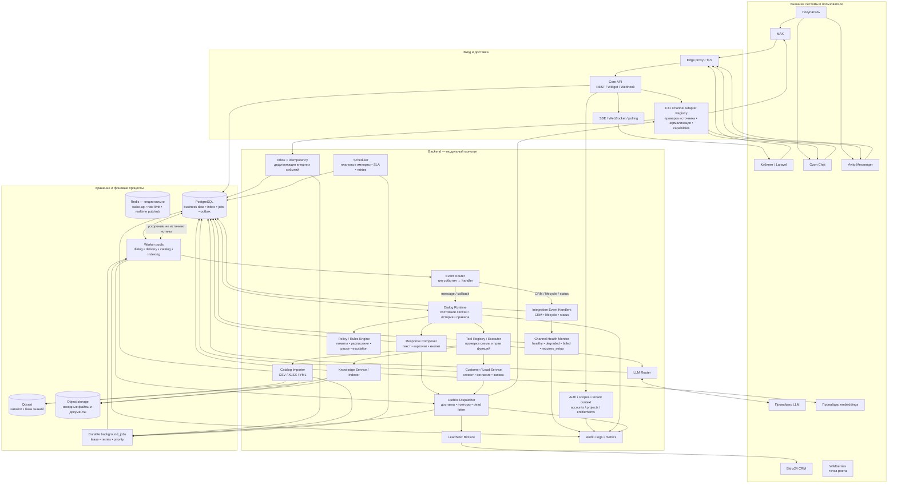
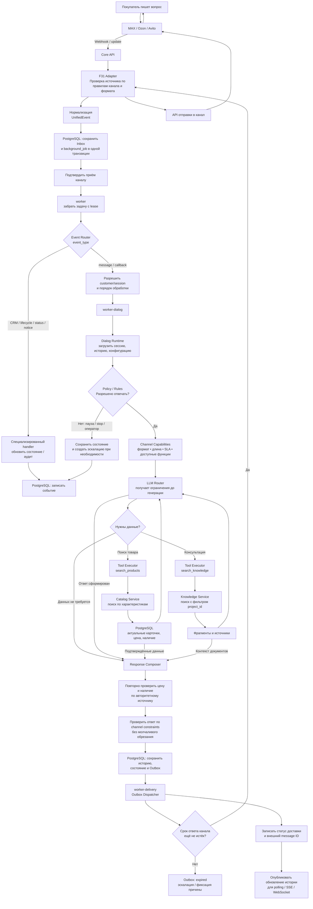
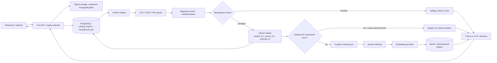
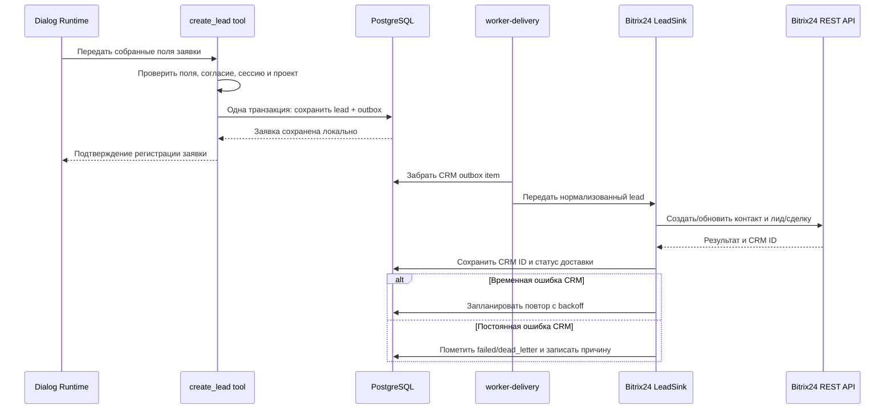
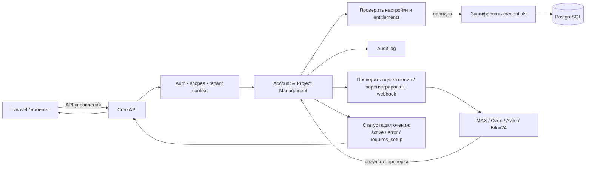

# Блок-схема сервиса «ИИ-продавец»

## 1. Общая схема сервиса

Сервис реализуется как модульный backend: API и разные профили worker запускаются отдельными процессами, но используют общие доменные модули. Внешние мессенджеры и CRM подключаются адаптерами. PostgreSQL хранит исходные бизнес-данные и состояния обработки, Qdrant — производные векторные индексы.

### Обозначение узлов

- **Core API** — принимает запросы кабинета и виджета, а также webhook внешних платформ. Не ждёт завершения генерации ответа внутри webhook-запроса.
- **F31 Adapter Registry** — переводит протокол конкретного мессенджера в канонический формат ядра и обратно. Не выбирает товары и не формирует коммерческую логику.
- **Inbox** — сохраняет принятое событие и предотвращает повторную обработку одного события поставщика.
- **Event Router** — направляет сообщения и callbacks в диалоговый runtime, а CRM-, lifecycle-, delivery-status и системные события — в соответствующие обработчики. Немесседжные события не превращаются в сообщения с пустым текстом.
- **Channel Health Monitor** — различает временную деградацию внешнего провайдера и исправимые настройки подключения; показывает причину, если она подтверждена.
- **Durable `background_jobs`** — задания для worker. PostgreSQL хранит их надёжно; Redis, если подключён, используется только как вспомогательный транспорт/сигнал.
- **Dialog Runtime** — управляет жизненным циклом сообщения: состояние сессии, история, правила, вызов функций и получение результата.
- **Tool Executor** — исполняет только разрешённые функции с серверной валидацией аргументов. Модель не обращается к БД и интеграциям напрямую.
- **Catalog / Knowledge** — каталог хранит подтверждённые характеристики, цену и наличие; база знаний отвечает на консультационные вопросы.
- **Response Composer** — формирует канонический ответ и проверяет, что коммерческие значения взяты из доверенного источника.
- **Outbox** — фиксирует сообщения и события, которые необходимо доставить во внешнюю систему, и обеспечивает безопасные повторы.
- **Worker pools** — отдельные процессы одного backend-приложения. Диалоговые задачи отделены от импорта и индексации, чтобы тяжёлая обработка каталога не задерживала покупателя.

## 2. Обработка входящего события

### Важные свойства потока

1. Webhook подтверждается только после сохранения типизированного события и durable background job в PostgreSQL.
2. Повторный webhook не создаёт второе сообщение и второй запуск обработки.
3. Долгий вызов LLM не удерживает соединение с платформой мессенджера.
4. Диалог обрабатывается последовательно в рамках одной сессии; независимые сессии работают параллельно.
5. Модель может предложить вызвать tool, но сервер проверяет схему, права и контекст перед исполнением.
6. Цена, валюта, наличие и характеристики при отправке ответа повторно читаются из авторитетного каталога или provider. Если значение неизвестно или устарело, оно не выдаётся как факт.
7. Отправка ответа выполняется через Outbox после фиксации истории. Ошибка канала обновляет статус доставки и запускает ограниченную retry policy.
8. Состояние `degraded` обозначает временный сбой провайдера и не требует от клиента менять credentials. `requires_setup` используется для подтверждённой проблемы настройки, прав или подписки.
9. Wildberries остаётся точкой роста; транспорт и набор поддерживаемых операций определяются только отдельной спецификацией после проверки официального API.

## 3. Поток загрузки каталога

PostgreSQL хранит текущие товарные данные; Qdrant используется только для поиска/ранжирования и восстанавливается из первичных данных. Коммерческие поля для ответа покупателю не берутся из векторного индекса.

## 4. Поток создания заявки и Bitrix24

Покупателю можно подтвердить создание заявки после успешного сохранения во внутренней БД. Доступность Bitrix24 не должна приводить к потере заявки или блокировать текущий ответ.

## 5. Поток настройки интеграции и конфигурации

Секреты доступны только серверному адаптеру при вызове API. Они не возвращаются кабинету повторно в открытом виде, не передаются в LLM и не включаются в логи.

## 6. Обработка ошибок и повторы

```mermaid
flowchart TD
    Start["Worker забрал задачу с lease"] --> Execute["Вызвать внутренний handler или внешний API"]
    Execute --> Result{"Результат"}
    Result -->|"Успех"| Commit["Зафиксировать результат и завершить задачу"]
    Result -->|"Временная ошибка"| RetryCheck{"Попытки ещё доступны?"}
    RetryCheck -->|"да"| Schedule["Рассчитать backoff + jitter;<br/>записать available_at"]
    Schedule --> Pending["Вернуть задачу в pending/retrying"]
    RetryCheck -->|"нет"| Dead["dead_letter / failed"]
    Result -->|"Постоянная ошибка"| Dead
    Dead --> Alert["Статус интеграции / метрика / диагностика"]
    Pending --> WorkerLoop["Worker заберёт позже"]
```

Внешние HTTP-вызовы выполняются с таймаутами и ограничением конкурентности. Повтор допускается только с идемпотентной операцией либо с механизмом сопоставления результата, предотвращающим дубли.

## 7. Что запускается при разработке и в production

| Профиль запуска | Основная работа |
|---|---|
| `api` | Управляющий API, публичный API сообщений, webhook ingress и чтение истории |
| `worker-dialog` | Входящие сообщения, сессии, runtime, LLM и инструменты |
| `worker-delivery` | Исходящие сообщения, CRM, webhook-уведомления и повторы Outbox |
| `worker-catalog` | Импорт и нормализация каталога |
| `worker-indexing` | Индексация/удаление векторов каталога и базы знаний |
| `scheduler` | Плановые задания, SLA и запуск готовых повторов |
| PostgreSQL | Бизнес-данные, история, Inbox, durable jobs, Outbox и аудит |
| Qdrant | Векторные индексы; источник данных — PostgreSQL/документы |
| Object storage | Исходные файлы импорта и документы |
| Redis (опционально) | Ускорение пробуждения worker, rate limiting и real-time pub/sub; не источник истины |

Профили могут быть сведены в меньшее количество процессов на раннем этапе разработки, но API webhook и долгие фоновые задачи должны оставаться разделены логически. Перед production диалоговую обработку следует изолировать от импорта и индексации.
