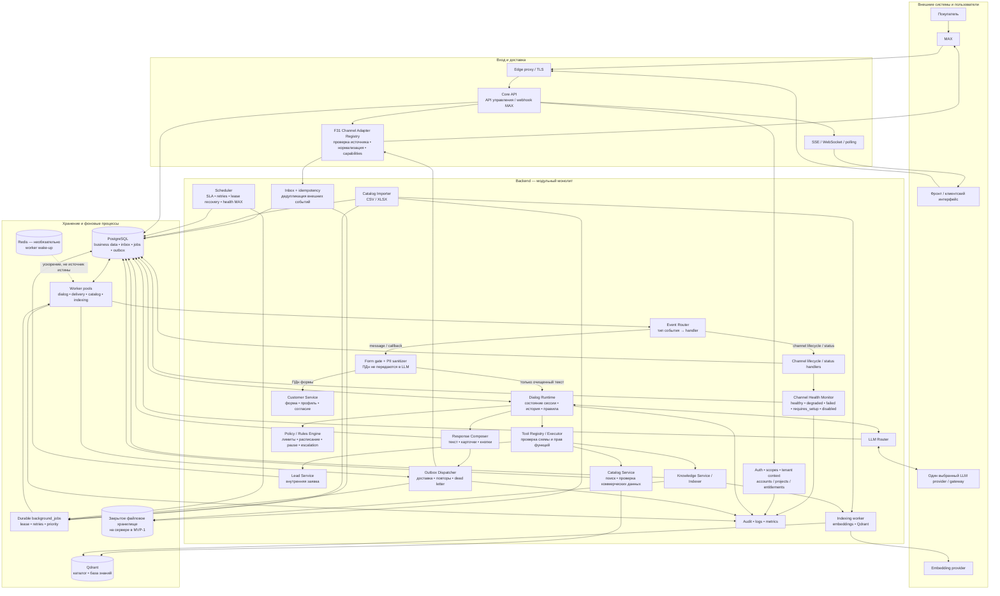
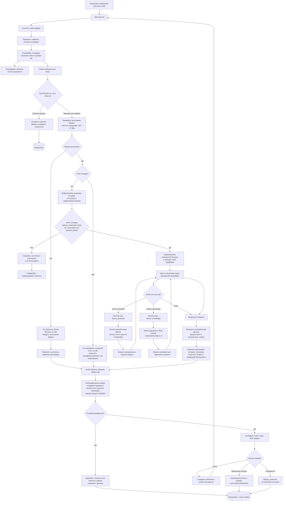
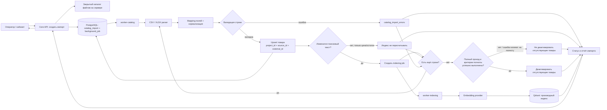
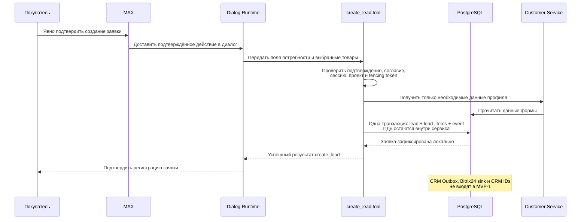
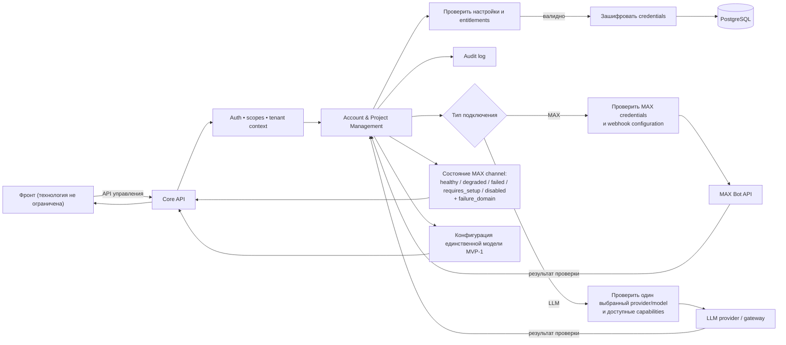
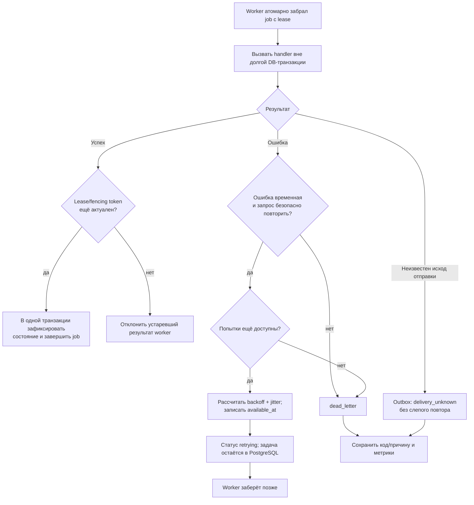

# Блок-схема сервиса «ИИ-продавец»

## 1. Общая схема сервиса

Сервис реализуется как модульный backend: API и разные профили worker запускаются отдельными процессами одного приложения. В MVP-1 подключается только MAX; CRM и другие каналы остаются за границами первой версии. PostgreSQL хранит исходные бизнес-данные и состояния обработки, Qdrant — производные векторные индексы.

### Обозначение узлов

- **Core API** — предоставляет API фронту и принимает webhook MAX. Не ждёт завершения генерации ответа внутри webhook-запроса.
- **F31 Adapter Registry** — переводит протокол конкретного мессенджера в канонический формат ядра и обратно. Не выбирает товары и не формирует коммерческую логику.
- **Inbox** — сохраняет принятое событие и предотвращает повторную обработку одного события поставщика.
- **Event Router** — направляет message/callback события MAX в диалоговый runtime, а события жизненного цикла канала и статуса — в специализированные обработчики. Немесседжные события не превращаются в сообщения с пустым текстом; неизвестные события сохраняются как unsupported/ignored с диагностикой.
- **Channel Health Monitor** — хранит состояния `healthy`, `degraded`, `failed`, `requires_setup`, `disabled` и подтверждённую причину сбоя (`failure_domain`); временный outage не требует от клиента менять корректные credentials.
- **Durable `background_jobs`** — задания для worker. PostgreSQL хранит их надёжно; Redis, если подключён, используется только как вспомогательный транспорт/сигнал.
- **Dialog Runtime** — управляет жизненным циклом сообщения: состояние сессии, история, правила, вызов функций и получение результата.
- **Tool Executor** — исполняет только разрешённые функции с серверной валидацией аргументов. Модель не обращается к БД и интеграциям напрямую.
- **Catalog / Knowledge** — каталог хранит подтверждённые характеристики, цену и наличие; база знаний отвечает на консультационные вопросы.
- **Response Composer** — формирует канонический ответ и проверяет, что коммерческие значения взяты из доверенного источника.
- **Outbox** — фиксирует исходящие ответы MAX для асинхронной доставки. CRM-доставка не входит в MVP-1.
- **Worker pools** — отдельные процессы одного backend-приложения. Диалоговые задачи отделены от импорта и индексации, чтобы тяжёлая обработка каталога не задерживала покупателя.

## 2. Обработка входящего события

### Важные свойства потока

1. Webhook подтверждается только после сохранения типизированного события и durable background job в PostgreSQL.
2. Повторный webhook не создаёт второе сообщение и второй запуск обработки.
3. Долгий вызов LLM не удерживает соединение с платформой мессенджера.
4. Диалог обрабатывается последовательно в рамках одной сессии; независимые сессии работают параллельно.
5. Модель может предложить вызвать tool, но сервер проверяет схему, права и контекст перед исполнением.
6. Цена, валюта, наличие и характеристики при отправке ответа повторно читаются из авторитетного каталога или provider. Если значение неизвестно или устарело, оно не выдаётся как факт.
7. Отправка ответа выполняется через Outbox после фиксации истории. Ошибка канала обновляет статус доставки и запускает ограниченную retry policy.
8. Состояние `degraded` обозначает временный сбой провайдера и не требует от клиента менять credentials. `requires_setup` используется для подтверждённой проблемы настройки, прав или подписки.
9. MVP-1 включает только канал MAX. Ozon, Avito, CRM и Wildberries не участвуют в этом потоке; новые подключения добавляются отдельными этапами через адаптеры.
10. Payload Inbox и технические данные webhook не являются обычной историей диалога: ПДн в них минимизируются, шифруются или удаляются по установленной политике хранения.

## 3. Поток загрузки каталога

PostgreSQL хранит текущие товарные данные; Qdrant используется только для поиска/ранжирования и восстанавливается из первичных данных. Коммерческие поля для ответа покупателю не берутся из векторного индекса.

## 4. Поток создания внутренней заявки (MVP-1)

Заявка хранится внутри сервиса и доступна через API проекта. Её создание требует явного подтверждения покупателя; вызов модели сам по себе не считается подтверждением. CRM-доставка относится к MVP-2.

## 5. Поток настройки интеграции и конфигурации

Секреты доступны только серверному адаптеру при вызове API. Они не возвращаются кабинету повторно в открытом виде, не передаются в LLM и не включаются в логи.

## 6. Обработка ошибок и повторы

Внешние HTTP-вызовы выполняются с таймаутами и ограничением конкурентности. Смена владельца session lease определяется выдачей нового fencing token. Истёкшее время lease само по себе token не меняет. Неопределённый исход отправки MAX фиксируется как `delivery_unknown`; автоматический повтор допустим только при подтверждённой идемпотентности либо после сверки статуса.

## 7. Что запускается при разработке и в production

| Профиль запуска | Основная работа |
|---|---|
| `api` | API фронта, webhook ingress MAX, управление и чтение истории |
| `worker-dialog` | `inbound_dialog`: входящие MAX events, сессии, Dialog Runtime, LLM и tools |
| `worker-delivery` | `outbound_delivery`: ответы MAX через Outbox |
| `worker-catalog` | `catalog_import`: импорт CSV/XLSX и отчёты |
| `worker-indexing` | `indexing`: embeddings и индексация/удаление Qdrant vectors |
| `scheduler` | Повторы, SLA, lease recovery и health MAX |
| PostgreSQL | Бизнес-данные, история, Inbox, durable jobs, Outbox и аудит |
| Qdrant | Векторные индексы; источник данных — PostgreSQL/документы |
| Закрытый каталог файлов на сервере | Исходные файлы импорта и документы в MVP-1 |
| Redis (необязательно) | Только сигнал для пробуждения worker; при недоступности jobs продолжают обрабатываться polling из PostgreSQL |

Все профили — процессы одного модульного монолита и запускаются на MVP-1 напрямую на Linux-сервере под `systemd`; контейнеризация не используется. Профили могут быть сведены в меньшее количество процессов при разработке, но webhook/API и долгие фоновые задачи остаются разделены логически. CRM delivery, Ozon, Avito, виджет и другие каналы не входят в MVP-1.
