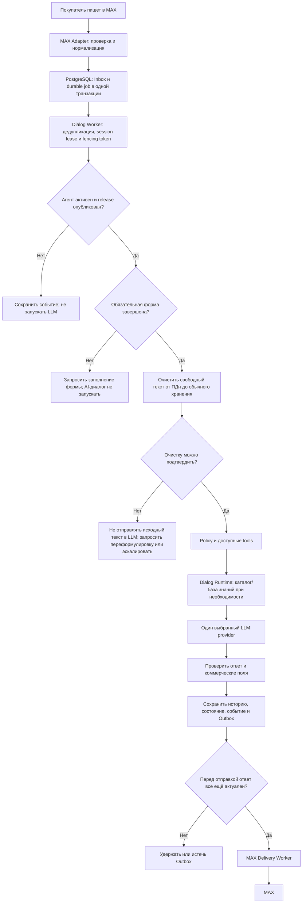

# Архитектура ядра сервиса «ИИ-продавец»

> **Источник истины — [BACKEND_MVP_TZ.md](BACKEND_MVP_TZ.md).** Этот документ описывает архитектурные границы и связи компонентов, но не расширяет состав MVP-1. При расхождении требований приоритет всегда у ТЗ.

## 1. Назначение и границы

Ядро принимает события каналов и команды API, обрабатывает их, хранит бизнес-состояние и возвращает результаты через API или исходящий канал. Веб-кабинет, сайт, редактор конфигурации, биллинг и платёжные операции не входят в backend.

MVP-1 — модульный монолит для одного ИИ-продавца в проекте. Система развёртывается на одном Linux-сервере без контейнеризации. Модули имеют отдельные зоны ответственности и прикладные контракты, но не являются независимо развёртываемыми микросервисами.

### Обязательные границы MVP-1

| Область | MVP-1 |
|---|---|
| Канал | Только MAX |
| Модель | Один выбранный LLM-провайдер за внутренним интерфейсом; без переключения и fallback между провайдерами |
| Каталог | Один авторитетный источник CSV/XLSX |
| База знаний | Загружаемые PDF/DOCX/TXT документы |
| Заявки | Внутренние заявки; создание только после явного подтверждения покупателя |
| Персональные данные | Обязательная форма до начала AI-чата; персональные данные в LLM не передаются |
| Хранилище | PostgreSQL — источник истины; Qdrant — производный векторный индекс; Redis необязателен |
| Операторы | Owner/admin/operator с ограничениями доступа из ТЗ |
| Развёртывание | `api` и worker-профили как процессы одного приложения под `systemd`; без контейнеризации |

CRM, дополнительные каналы, дополнительные LLM-провайдеры/маршрутизация, YML/API-синхронизация каталога и другие интеграции относятся к последующим этапам. Их нельзя считать реализованными функциями MVP-1 только потому, что для них предусмотрен расширяемый интерфейс.

## 2. Архитектурные принципы

### 2.1. Владение данными и доступ

Основная иерархия: `account → project → agent`. В MVP-1 у проекта один ИИ-продавец. Пользователи, роли и entitlements принадлежат аккаунту; канал, агент, каталог, база знаний, покупатели, диалоги и заявки — проекту.

API проверяет подписанный JWT, срок действия, issuer, audience и scopes, а затем проверяет членство аккаунта и связь каждого project resource с аккаунтом. Роль или ID, переданные в теле запроса или заголовке без проверки токена, не являются доказательством доступа. Матрица ролей:

- `owner` управляет аккаунтом и всеми проектными данными, участниками/ролями, назначением операторов, политикой возобновления и безопасным повторным запуском.
- `admin` управляет настройками проекта, агентом, каналом, каталогом и базой знаний; просматривает диалоги и управляет эскалациями, но не управляет владельцем аккаунта.
- `operator` видит назначенные ему диалоги и открытые неназначенные эскалации, которые может атомарно принять. Отвечает только в назначенном диалоге с открытой эскалацией; не видит остальные диалоги и не меняет настройки, credentials, релизы или роли.

Полные scopes, правила доступа, допустимые переходы и ошибки API фиксируются в API-контракте, предусмотренном ТЗ.

### 2.2. Источники истины

- **PostgreSQL** хранит бизнес-состояние, Inbox, durable jobs, Outbox, историю диалогов, результаты импорта, конфигурации, аудит и учёт LLM.
- **Qdrant** хранит производные поисковые представления каталога и базы знаний. Его данные восстанавливаются из PostgreSQL и исходных документов. При ответе о цене, наличии и других коммерческих значениях авторитетны PostgreSQL или явно подключённый поставщик данных, но не векторный индекс.
- **Redis** необязателен и не является источником истины для задач, событий, сессий или доставки. При его отсутствии workers забирают задания из PostgreSQL polling-ом.
- Исходные импорты и поддерживаемые документы хранятся в закрытом файловом каталоге сервера с ограниченным доступом и резервным копированием. Переход на S3-compatible хранилище — возможный этап роста, не требование MVP-1.

Доставка фоновых задач — at-least-once с идемпотентной обработкой, а не обещание exactly-once для внешних HTTP-вызовов.

### 2.3. Конфигурация агента и сессия

Изменения агента сначала сохраняются как draft. Публикация атомарно создаёт неизменяемый release snapshot. Новая сессия закрепляется за активным release; существующая продолжает использовать ранее закреплённый release. Откат переключает активный release для новых сессий, не меняя содержимое опубликованных релизов.

Состояния агента: `draft`, `active`, `paused`, `disabled`. Только `active` создаёт новые задачи LLM и автоматические ответы. События при `paused`/`disabled` сохраняются; старые сообщения не обрабатываются автоматически после возобновления. Входящие события без активного агента или опубликованного release не запускают AI-обработку.

Для последовательной обработки сессии worker получает PostgreSQL lease и монотонный fencing token. Истечение времени lease само по себе не передаёт владение: новый владелец получает новый token. Перед сохранением результата, изменением сессии или созданием Outbox worker проверяет актуальность token под блокировкой строки сессии. Внешние вызовы выполняются вне долгой бизнес-транзакции.

## 3. Компоненты и процессы

Все компоненты используют общие доменные контракты и PostgreSQL. API и workers не вызывают друг друга по внутреннему HTTP: долгие операции передаются через durable jobs.

| Компонент / профиль | Ответственность |
|---|---|
| Edge proxy / ingress | HTTPS/TLS, маршрутизация, ограничения размера запросов и базовая защита периметра |
| `api` | REST API управления и диалогов, MAX webhook ingress, аутентификация, авторизация, валидация, OpenAPI, SSE/WebSocket или polling |
| Account & Project | Аккаунты, проекты, роли, entitlements, проверки tenant ownership |
| Agent Configuration | Draft, публикация неизменяемых релизов и состояния агента |
| Channel Registry / MAX Adapter | Credentials, capabilities и health MAX; проверка и нормализация событий; преобразование исходящих ответов |
| Inbox / Event Router | Дедупликация, durable фиксация принятого события, маршрутизация типизированного события |
| `worker-dialog` / Dialog Runtime | Последовательная обработка диалога, политика, вызовы разрешённых tools и LLM, формирование ответа |
| Tool Registry / Executor | Публикация разрешённых функций, JSON Schema и серверная валидация/исполнение |
| Catalog Service / `worker-catalog` | Импорт CSV/XLSX, mapping, проверки полноты, upsert в PostgreSQL |
| Knowledge Service / `worker-indexing` | Извлечение текста из PDF/DOCX/TXT, разбиение, embeddings и обновление Qdrant |
| LLM Provider Adapter | Вызов единственного выбранного провайдера через внутренний интерфейс, таймауты, классификация ошибок и учёт |
| Response Composer | Сбор текста и карточек только из проверенных результатов; валидация ответа по MAX capabilities |
| `worker-delivery` / Outbox | Повторная проверка актуальности ответа и асинхронная доставка в MAX |
| Lead & Customer | Профиль покупателя, согласие и внутренние заявки |
| `scheduler` | Восстановление lease, повторные задачи, SLA и проверки health MAX |
| Realtime Publisher | Публикация сохранённых сообщений/статусов операторскому интерфейсу или фронту |
| Audit & Telemetry | Структурированные логи, метрики, события и аудит административных действий |

Профили `api`, `worker-dialog`, `worker-delivery`, `worker-catalog`, `worker-indexing` и `scheduler` запускаются как процессы одного backend-приложения под `systemd`. Они могут быть объединены для ранней разработки, но не должны превращаться в отдельные микросервисы MVP.

## 4. Сквозная обработка входящего сообщения

Для webhook входной путь проверяет требования провайдера и формат payload, затем сохраняет Inbox и `background_jobs` в одной транзакции. ACK возвращается только после фиксации. Повтор события не запускает повторное бизнес-действие. Диалог и доставка выполняются асинхронно.

До создания Outbox результат проверяется на актуальность товара, цены и наличия, возможности MAX и ограничения активной сессии. Непосредственно перед отправкой worker повторно проверяет состояние агента, deadline, открытую эскалацию, операторскую паузу, актуальность диалога и fencing token. Неактуальная отправка удерживается/истекает. Если результат внешнего вызова MAX неизвестен, запись получает `delivery_unknown`; автоматический повтор допустим только при доказанной идемпотентности или успешной сверке.

## 5. Канал и интеграционный контракт

F31 отделяет протокол канала от бизнес-логики. В MVP-1 реализуется только адаптер MAX; его точные endpoint-ы, форматы и ограничения определяются официальной документацией и [EXTERNAL_INTEGRATIONS.md](EXTERNAL_INTEGRATIONS.md).

Внутренний `InboundEvent` содержит устойчивый event ID, тип, канал, временные отметки, версию схемы, correlation ID, provider metadata и типизированный payload. Message и callback события направляются в Inbox/Dialog Runtime; другие поддерживаемые события обрабатываются соответствующим модулем либо сохраняются как `unsupported`/`ignored` с диагностикой. Сетевые форматы MAX не выходят за границу адаптера.

`ChannelCapabilities` MAX учитываются до генерации и повторно проверяются после неё. Поддерживаемые MAX сообщения, callbacks, клавиатуры, медиа, лимиты длины и правила доставки реализуются только в объёме, подтверждённом актуальным API и интеграционной спецификацией. Бизнес-логика продаж и выбор товара не размещаются в адаптере.

Входящие изображения получают и проверяют через media adapter. Анализ возможен только выбранной vision-capable моделью и после прохождения требований по персональным данным; иначе покупателю сообщается об ограничении либо создаётся эскалация.

CRM, Ozon Chat, Avito Messenger и дополнительные каналы — последующие этапы. Для каждого нового поставщика нужна отдельная проверка его официального API и отдельная спецификация; наличие F31 само по себе не означает совместимость.

## 6. LLM, tools и персональные данные

### 6.1. LLM boundary

В MVP-1 работает один выбранный LLM-провайдер за расширяемым интерфейсом. Маршрутизации и fallback к другому provider нет. Конкретный провайдер не считается утверждённым этим документом. Для выбранного provider до production проверяются retention, использование данных для обучения, регион обработки и субпроцессоры.

Конфигурация выбранной модели включает метаданные поддерживаемых возможностей: tools, temperature, vision и размер контекстного окна. Backend до вызова проверяет бюджет, лимиты, размер истории и возможности модели. Ошибки обрабатываются явно, с ограниченными безопасными повторами и эскалацией либо нейтральным сообщением; ошибка не маскируется успешным ответом. Учёт вызовов, токенов, длительности и ошибок ведётся в `llm_calls`.

### 6.2. Путь персональных данных

1. До начала AI-чата покупатель заполняет обязательную форму. До её завершения обычный AI-диалог и вызов LLM не начинаются.
2. Данные формы и согласие хранятся во внутреннем профиле покупателя. В CRM их можно передавать только при настроенной интеграции и разрешённом маршруте; CRM-интеграция не входит в MVP-1.
3. До обычного сохранения свободного сообщения и до любого LLM-вызова обнаруженные прямые идентификаторы маскируются или удаляются. В обычной истории и логах хранится только очищенный текст.
4. Если очистку нельзя уверенно подтвердить, исходный текст не отправляется LLM; покупателя просят переформулировать сообщение либо диалог передаётся оператору.
5. В LLM не передаются идентификаторы покупателя/канала, контактные данные из формы или переписки, credentials, платёжные реквизиты и внутренние заметки оператора. Вложения/изображения, которые могут содержать ПДн, не отправляются без отдельной проверки и подтверждённого обезличивания.

Маскирование ПДн в логах/трассировке, ограничение хранения и удаление данных из профиля, истории, активных jobs/Outbox и производных индексов выполняются по требованиям ТЗ. Персональные данные не отправляются LLM независимо от региона или заявленного режима provider.

### 6.3. Реестр инструментов MVP-1

Модель может запросить только доступные backend-функции. MVP-1 включает:

- `search_products` и `get_product` — поиск и получение сведений из каталога;
- `create_lead` — внутренняя заявка, только после явного подтверждения покупателя;
- `escalate_to_operator` — передача диалога оператору.

Контекст проекта и сессии подставляет backend. Аргументы валидируются по схеме и правам. Цены, наличие и характеристики для коммерческого ответа подтверждаются PostgreSQL или подключённым авторитетным источником; модель не должна их придумывать или пересчитывать. Доступ к инструментам, не реализованным в MVP-1, не создаётся только ради будущей расширяемости.

## 7. Каталог, база знаний и заявки

### Каталог

Импорт MVP-1 — CSV/XLSX из одного авторитетного источника проекта. Backend валидирует строки и mapping, фиксирует ошибки и признак полноты импорта. Отсутствующие товары можно деактивировать только после завершённого полного импорта, прошедшего проверки полноты. Валидные товары сохраняются в PostgreSQL; задания индексации обновляют производный индекс Qdrant.

Qdrant используется для семантического поиска, но не заменяет точные фильтры и авторитетную запись товара. Перед отправкой карточки/цены backend перечитывает актуальные данные. YML, API push, расписания и множественные источники относятся к MVP-2.

### База знаний

MVP-1 поддерживает документы PDF/DOCX/TXT: загрузку, извлечение текста, разбиение на фрагменты, индексирование в Qdrant и tenant-фильтрацию по проекту. Для retrieval предусмотрены режимы `always`, `auto` и `on_demand`, порог релевантности и ограничения количества/размера фрагментов в контексте. Отсутствие надёжного источника не маскируется уверенным выдуманным ответом. Импорт сайта/sitemap и обработка веб-источников относятся к последующим этапам.

### Внутренние заявки

`create_lead` сохраняет заявку в PostgreSQL вместе с сессией, customer, согласием, товарами и явным подтверждением покупателя. Повтор команды идемпотентен. Заявки доступны через API с учётом ролей; их создание не зависит от CRM. CRM sink, синхронизация и статусы внешних сделок — после MVP-1.

## 8. Outbox, эскалации и согласованность

Изменение бизнес-состояния и соответствующие доменные события/Outbox фиксируются в одной короткой PostgreSQL-транзакции. Вызовы MAX, LLM и Qdrant не выполняются внутри долгой бизнес-транзакции.

У Outbox есть idempotency key, срок актуальности, число попыток, следующее время запуска, статус и диагностическая причина. Временная ошибка допускает ограниченный provider-specific retry/backoff; постоянная ошибка и исчерпание попыток явно фиксируются как failure/dead-letter. Истёкший ответ не отправляется.

На сессию допускается не более одной открытой эскалации. Операторская пауза блокирует новые автоответы. Назначение/принятие эскалации и старт исходящей отправки синхронизируются блокировкой сессии, чтобы удержать или отменить ещё не начатые автоматические отправки. Оператор отвечает только в назначенном ему диалоге при открытой эскалации. Автоматическое возобновление и ручной повтор старых сообщений подчиняются правам и политике проекта.

## 9. Развёртывание и эксплуатация

Минимальная и рекомендуемая конфигурация сервера, сетевые ограничения, версии ПО и требования к резервным копиям заданы в разделе 0 ТЗ. В архитектуре MVP используются Python 3.12, PostgreSQL 16, Qdrant, reverse proxy для HTTPS и закрытое файловое хранилище. Redis 7 подключается только при необходимости и не заменяет PostgreSQL durable jobs.

Процессы запускаются на Linux под `systemd`, без Docker/контейнеризации. Workers имеют ограниченную конкурентность; импорт и индексация не должны вытеснять обработку диалогов. Health/readiness, graceful shutdown, структурированные логи, метрики очередей/API/MAX/LLM/импорта/доставки и резервное копирование обязательны согласно ТЗ. Секреты и неочищенные персональные данные не попадают в репозиторий, логи и диагностические ответы.

## 10. Основные логические сущности

Ниже приведена логическая карта, а не замена схемы БД и ограничений из ТЗ.

| Группа | Сущности |
|---|---|
| Владение и доступ | `accounts`, `account_memberships`, `projects`, `entitlements` |
| Агент | `agents`, `agent_drafts`, `agent_releases` |
| Канал и обработка | `channels`, `inbox`, `background_jobs`, `outbox` |
| Каталог | `catalog_sources`, `catalog_imports`, `catalog_import_errors`, `products` |
| База знаний | `kb_documents`, `kb_chunks` |
| Покупатели и диалоги | `customers`, `customer_identities`, `chat_sessions`, `chat_messages`, `dialog_variables`, `customer_variables` |
| Продажи и операторы | `tool_executions`, `leads`, `lead_items`, `escalations` |
| Аудит и расходы | `events`, `audit_log`, `llm_calls`, `usage_counters` |

Рабочий OTP-flow и автоматическое межканальное объединение identities не входят в MVP-1. Контакт со статусом `unverified` не подтверждает личность и не является основанием для объединения customer identities.

## 11. Этапы после MVP-1

По ТЗ к последующим этапам относятся:

- дополнительные каналы и самостоятельный публичный API виджета;
- CRM (включая Bitrix24) и синхронизация внутренних заявок;
- дополнительные LLM-провайдеры и маршрутизация между моделями;
- YML/API-источники каталога, расписания синхронизации, несколько источников и приоритеты полей;
- расширенная операторская очередь, аналитика и администрирование.

Telegram, VK, WhatsApp Business API, Wildberries, Яндекс.Маркет, 1С, МойСклад и amoCRM остаются будущими интеграциями. Платёжный биллинг, произвольное выполнение кода клиента, дообучение LLM, полноценный визуальный редактор, сложные A/B-эксперименты и массовые рассылки находятся вне текущего MVP-1/MVP-2 scope согласно ТЗ.

## 12. Связанные документы

- [BACKEND_MVP_TZ.md](BACKEND_MVP_TZ.md) — нормативные требования, модель данных, API, безопасность, порядок разработки и критерии приёмки.
- [SERVICE_BLOCK_DIAGRAM.md](SERVICE_BLOCK_DIAGRAM.md) — визуальные схемы компонентов и потоков.
- [EXTERNAL_INTEGRATIONS.md](EXTERNAL_INTEGRATIONS.md) — отдельная спецификация внешних подключений, включая MAX.
- [README.md](README.md) — индекс документации и структура проекта.
